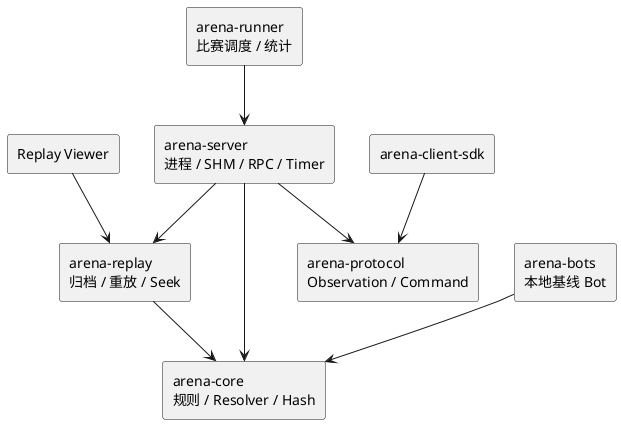

# 架构与模块边界

## P-ARCH-01 工程原则

| 优先级 | 原则 | 约束 |
|---|---|---|
| 1 | 先规则，后基础设施 | Core 可让两个本地 Bot 完赛前，不建设账号、云部署或公开匹配 |
| 2 | Server 是唯一权威状态源 | Client 只执行 `Read Observation → Compute → Submit Commands`，不得修改状态或 RNG |
| 3 | 确定性优先 | MVP 规模小，优先级为 Determinism > Correctness > Debuggability > Performance |
| 4 | Core 与 Runtime 分离 | 网络、进程、共享内存和计时不能进入纯游戏逻辑 |
| 5 | 可见性靠边界保证 | SDK 和 OS 映射只暴露该阵营可见数据，不能只靠调用约定隐藏字段 |

## P-ARCH-02 组件关系



`arena-core` 不依赖网络或操作系统；它包含 geometry、map、portal、agent、action、resolver、field、scoring、rng、event，以及生成 Replay 记录和状态 Hash 所需的纯逻辑。存储、进程和展示分别留在边界组件。

## P-ARCH-03 推荐 Workspace

Rust 适合本项目对确定性、性能、进程隔离和 Shared Memory 的要求。推荐模块如下；语言选择不改变边界原则。

| 路径 | 职责 |
|---|---|
| `crates/arena-core` | 权威数据模型与纯确定性结算 |
| `crates/arena-protocol` | 版本化 Observation、Command 与 RPC 消息 |
| `crates/arena-server` | Runtime、计时、SHM/RPC 和进程管理 |
| `crates/arena-client-sdk` | 参赛者 API，只暴露合法观察 |
| `crates/arena-bots` | Random、Nearest、Greedy、DestroyAnchor、Hybrid |
| `crates/arena-runner` | 批量比赛、Seed、阵营交换、统计与排名 |
| `crates/arena-replay` | Replay 编解码、校验与 Checkpoint |
| `viewer/` | Replay UI |
| `bots/` | 独立 Client 示例与基准实现 |
| `tools/` | Replay CLI、Benchmark 和统计工具 |

## P-ARCH-04 SDK 边界

Client SDK 不暴露 Server 内部对象。本地 Bot 与外部 Client 复用同一套协议数据模型，核心接口概念保持精简：

```rust
trait Bot {
    fn on_round(&mut self, observation: &Observation) -> Vec<AgentCommand>;
}
```

`Observation` 只包含 [`R-VIS`](../rules/05-visibility-resolution-rng.md) 允许该阵营读取的信息。

## P-ARCH-05 MVP 前置范围外

在 Core 和 Self-play 验证完成前，不投入 Web Account、Authentication、Cloud Deployment、Public Matchmaking、Spectator Server、复杂 UI、永久排行榜、LLM API Integration、分布式 Server、数据库集群或复杂 Anti-Cheat。
