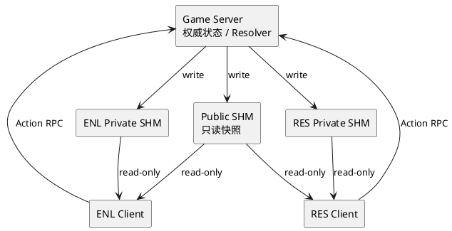

# P3—P4：外部 Runtime 与 Sandbox

仅在 Simulator 玩法基本稳定后，把本地 Bot 替换成两个独立 Client 进程；随后再加入正式比赛需要的资源与信息隔离。

## P3 进程与通信边界

Shared Memory 承担 Server → Client 的高频只读 Observation；RPC 承担 Client → Server 的动作和提交状态。不能把双方私有状态放入同一映射后只靠 SDK 隐藏字段。

## P3-SHM 快照分区与双缓冲

| 分区 | 内容 | Client 权限 |
|---|---|---|
| Public SHM | Public State、公开事件、Snapshot Metadata | ENL / RES 只读 |
| ENL Private SHM | ENL Agent 私有状态 | 仅 ENL 只读 |
| RES Private SHM | RES Agent 私有状态 | 仅 RES 只读 |

每个分区使用 Snapshot A/B 双缓冲。Round N 时 Client 读取 A，Server 写 B；写完后以原子元数据一次发布 `current_snapshot = B` 和新的 `snapshot_version`。下一轮角色互换，Client 永远不读 Server 正在修改的缓冲区。

## P3-RPC 最小协议

| 消息 | 方向 | 关键字段 / 语义 |
|---|---|---|
| `ROUND_START` | Server → Client | `round_id`、`snapshot_version`、`deadline` |
| `SUBMIT_ACTIONS` | Client → Server | `round_id`、各 Agent 的 Command Stream |
| `COMMIT_ROUND` | Client → Server | `round_id`；承诺不再提交本轮动作 |
| `ROUND_CLOSED` | Server → Client | 输入已关闭，后续旧 Round 动作丢弃 |
| `GAME_END` | Server → Client | 最终结果与可公开元数据 |

协议必须版本化，并明确消息大小、命令数量、重复提交、断线重连及 `action_id` 规则。行为必须与 [`R-RESOLVE`](../rules/05-visibility-resolution-rng.md) 一致。

## P3-TIMEOUT 时限

双方均 `COMMIT_ROUND` 时立即关闭本轮；否则到 deadline 强制关闭。Server 不等待慢 Client `READY`，关闭后到达的旧 `round_id` 动作直接丢弃，因此策略计算复杂度本身构成竞技约束。

## P3-GATE 完成门槛

Server 加两个外部 Client 能稳定完赛；一秒 deadline 生效；慢 Client 不阻塞 Server；在相同动作输入下，外部 Runtime 与本地 Simulator 产生相同 Core 状态和 Hash。

## P4 Sandbox 与资源公平

每个 Client 运行在独立 Container / cgroup，首版限制建议为：

| 资源 | 建议限制 |
|---|---|
| CPU | 2 cores |
| Memory | 2 GB |
| Threads | 限定上限 |
| External Network | disabled |
| Filesystem | read-only，仅开放临时目录 |

Server 使用独立、稳定的 CPU 与内存配额，不与 Client 竞争同一份 quota，避免 Client 通过负载影响结算时间。

## P4-GATE 完成门槛

Client 无法读取敌方 Private State、写 SHM 或访问外网；CPU / 内存限制生效；Client 超时或崩溃不导致 Server 崩溃，比赛可按既定策略继续并记录原因。
