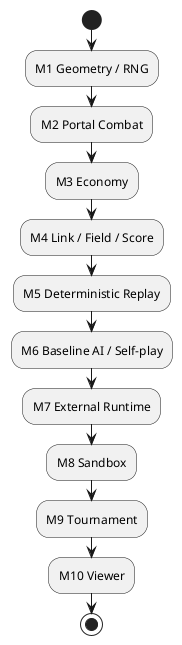

# 路线图与 MVP 验收

阶段 `P0`—`P6` 描述工程关注点；里程碑 `M1`—`M10` 是可独立验收的交付切片。

## 交付顺序

在 `M6` 用数千场比赛证明核心规则具备价值之前，不大规模投入竞技平台基础设施。

## M1—M10 里程碑

| 编号 | 交付内容 | 验收门槛 |
|---|---|---|
| `M1` Core Geometry | Portal、Agent、Move、Geometry、RNG | 坐标、相交、边界与随机源单测完善 |
| `M2` Basic Combat | Capture、Attack、Recharge、Portal Neutralize | 两个脚本 Agent 能完整争夺 Portal |
| `M3` Economy | Hack、Supply、Key、Transfer、Epoch Reset | 资源循环完整且边界可重放 |
| `M4` Field Game | Link、Field、Layered Field、Score | 单进程可完整运行 500 Round；首个可玩版本 |
| `M5` Replay | Replay Log、Deterministic Replay、State Hash | 1,000 场比赛 100% 重放得到相同 Final Hash |
| `M6` Baseline AI | 五种 Baseline、批量 Self-play、首轮调参 | 10,000 场比赛并产出第一份平衡分析 |
| `M7` External Runtime | Server、双 Client、SHM、RPC、Timeout | 外部 Client 与本地 Bot 的 Core 行为一致 |
| `M8` Sandbox | Container、资源限制、网络隔离、崩溃处理 | 信息与资源隔离测试通过 |
| `M9` Tournament | Batch Match、Seed Set、Faction Swap、Elo、Archive | 可追溯地批量运行并排名 |
| `M10` Viewer | 基础地图 Replay UI 与三种观察视图 | 可播放、跳转并正确呈现 Replay；MVP 完成 |

## MVP Done

| 编号 | 维度 | 验收条件 |
|---|---|---|
| `A-CORE` | Game Core | 支持全部 v0.1 规则；500 Round 稳定完赛；处理至少 200 Portal；不存在明显且不必要的高于 O(N²) 瓶颈 |
| `A-DETERMINISM` | Determinism | 相同 Server 版本下，`seed + config + submitted actions` 得到完全一致的逐轮 Hash 和 Final State |
| `A-RUNTIME` | Runtime | 双 Client 独立运行；deadline 生效；慢 Client 不阻塞；Client Crash 不导致 Server Crash |
| `A-ISOLATION` | Isolation | Client 不能读取敌方 Private State、写 Shared Memory 或访问默认关闭的外部网络 |
| `A-BALANCE` | Balance | 没有已知简单策略在绝大多数随机地图上以超过 90% 胜率碾压其他合理 Baseline |
| `A-OBSERVABILITY` | Observability | Replay 可定位每个动作及非法原因、Portal 变化、Link、Field 和逐轮 Score |

所有验收结果必须记录 Game Config、Seed Set、Server / Bot 构建版本和测试报告位置。

## 必须守住的原则

- 规则层：简单规则产生复杂策略，不以复杂机制掩盖单一最优解。
- 工程层：Simulator、正式 Server 与 Replay 共享同一个 Resolver。
- 竞技层：结果主要来自策略与计算方法，而不是 Scheduler 抖动、CPU 数量、RNG 顺序污染或状态泄漏。

## MVP 后候选方向

| 方向 | 候选内容 |
|---|---|
| 地图 | 障碍物、河流 / 道路、移动成本区域、Portal 类型 |
| Tournament | Swiss、Ladder、Season、Seed Challenge |
| AI Research | RL、MCTS、Multi-Agent Planning、Opponent Modeling、LLM + Planner Hybrid |
| 模式 | 不同地图尺寸和 Round 长度、Blitz、Long Game、Fixed Map Challenge |

角色技能、装备系统等非必要复杂度不进入上述候选项的默认优先级。
