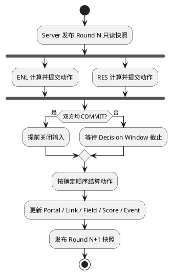

# 比赛、地图与增援

默认数值均引用 [`R-CONFIG`](./06-configuration.md)。

## R-TIME-01 Round 生命周期

游戏采用离散回合制；一个 Round 表示游戏世界中的一分钟。每轮 Client 在 `DECISION_WINDOW` 内基于同一版本快照提交动作。Server 不等待 Client `READY`；双方均 `COMMIT_ROUND` 时可提前关闭输入，超时 Client 的未提交动作视为放弃。

RPC 到达时间与 Server 执行耗时只影响动作是否赶上截止时间和排序，不计入游戏内时间或得分。

## R-TIME-02 比赛长度

比赛共 `TOTAL_ROUNDS` 轮。按默认一秒决策窗估算，单场 wall-clock 时间约八分钟，再加 Server 结算耗时；双方提前提交可缩短比赛。

## R-MAP-01 坐标与边界

- 地图是二维平面，不使用经纬度。
- 坐标为整数，单位为 `COORDINATE_UNIT`，以避免距离、相交和面积计算中的跨平台浮点差异。
- 地图尺寸、Portal 数量及最小间距分别由 `MAP_SIZE`、`PORTAL_COUNT`、`PORTAL_MIN_DISTANCE` 定义。

例如坐标 `(351230, 178452)` 在默认单位下表示 `(3512.30 m, 1784.52 m)`。

## R-MAP-02 Portal 分布

地图不采用完全均匀随机。默认由 `CLUSTERED_PORTAL_RATIO` 的聚集点和其余均匀点组成，在 `PORTAL_CLUSTER_COUNT` 个随机中心附近按高斯或类似分布采样，并始终满足最小间距。目标是同时产生高密度核心区、稀疏区、边缘 Anchor、战略走廊和不规则 Link 几何条件。

## R-SPAWN-01 初始出生

每阵营初始拥有 `INITIAL_AGENTS_PER_FACTION` 个 Agent。Server 公布完整地图后，ENL 与 RES 各自独立提交出生位置；两方提交结束后同时生效，提交前看不到对方选择。

## R-SPAWN-02 增援

每经过 `REINFORCEMENT_INTERVAL` 轮，每阵营增加 `REINFORCEMENT_AGENTS_PER_FACTION` 个 Agent；双方新增 Agent 出现在同一个由专用 RNG 生成的位置，以引入局势变化而不单独偏向某阵营。

| 可行动 Round | 每阵营 Agent 数 |
|---:|---:|
| 1—100 | 3 |
| 101—200 | 4 |
| 201—300 | 5 |
| 301—400 | 6 |
| 401—500 | 7 |

> 待确认 `Q-R-SPAWN-01`：原稿同时出现“Round 100 增援”和“Round 101 为 4 Agents”。上表按“Round 100 结算后生成、Round 101 起可行动”编排，需在冻结 v0.1 前确认。
