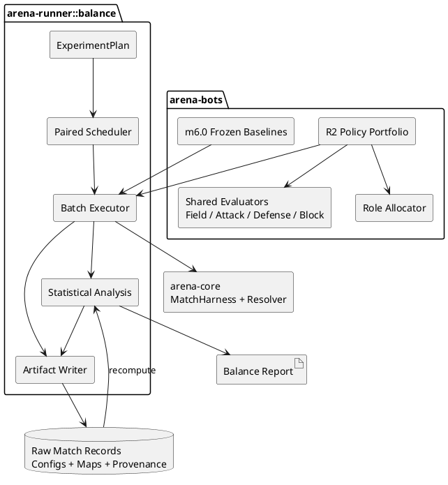
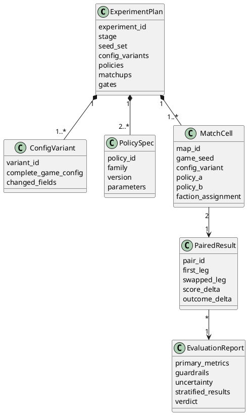
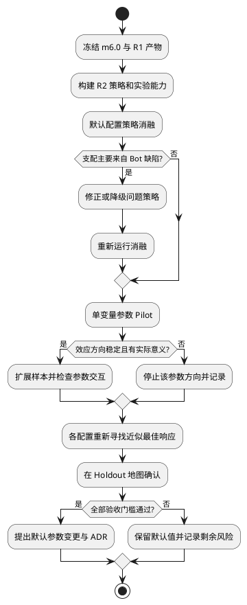

# AI 策略与参数平衡验证方案

- 状态：Proposed
- 适用阶段：MVP 完成后的 Balance R2
- 现有基线：`arena-bots m6.0`、`runs/m6-r1/`、`docs/balance/balance-report-r1.md`
- 日期：2026-09-03

## 1. 决策摘要

现有 `arena-bots m6.0` 应继续作为冻结的回归基线和机制探针，但不应单独承担默认参数决策。当前 10,000 场实验只覆盖一个 `GameConfig`，且有效的竞争性策略、关键机制与统计对照不足；它能够发现默认配置下的异常，却无法识别参数变化的因果效果。

下一阶段按以下顺序推进：

1. 冻结并保留 m6.0，不覆盖既有算法、版本和实验产物。
2. 先修正测量工具：消除 GreedyField 的己方竞争，建立多个都具备得分能力的 R2 策略族，并通过消融实验分离策略实现缺陷与规则效应。
3. 扩展 `arena-runner`，使其能够运行配置矩阵、同图换边配对、完整归档和按地图配对统计。
4. 先完成默认配置上的策略消融，再依次运行单变量参数敏感度实验。
5. 仅当结果在多个独立策略族和未参与调优的地图集上复现后，才修改规则默认值。

本方案不以“训练一个最强 AI”为目标。参数平衡需要的是覆盖不同决策逻辑、能够寻找近似最佳响应的策略组合，而不是依赖单一 Benchmark Bot。

## 2. 背景与问题定义

M6 已实现五种简单、可解释、固定版本的 Baseline Bot，并完成 10,000 场默认配置 Self-play。现有实现满足 MVP 对 Baseline 的定位，相关测试也覆盖了确定性、基本行为、重规划、合法性和批量重放。

现有证据同时暴露了以下限制：

- `runs/m6-r1/matches.tsv` 中只有一个 `config_hash`，未运行任何参数对照。
- NearestPortal 与 DestroyAnchor 不创建 Link，因而没有独立得分路径。
- GreedyField 的所有 Agent 使用同一站点顺序，压力场景下出现大量己方竞争和动作丢弃。
- Hybrid 使用与 GreedyField 相同的 FieldPlanner，但额外采用 per-Agent offset，并叠加攻击角色；二者的对局不能干净分离“组合策略收益”与“基础实现质量差异”。
- 所有 10,000 场比赛的 Transfer 次数为 0；Key Runner、主动 Blocker 和 Opponent Modeler 尚未进入策略池。
- Hybrid mirror 会在中立地图上选择相同最大三角和相同出生点，使第一轮冲突被放大为阵营偏差。
- 当前汇总主要提供计数和均值，缺少按地图配对效应、置信区间、分位数和地图类型分层。
- P2.5 要求的 Score Ratio、阵营分差分布和完整 Map Definition 归档尚不完整。

因此，本方案将当前能力界定为：

| 能力 | 当前可支持 | 当前不可支持 |
|---|---|---|
| 规则与状态机冒烟 | 发现崩溃、非法动作、状态机漏洞 | 证明复杂策略下不存在漏洞 |
| 默认配置诊断 | 发现 Hybrid 支配、Greedy 丢弃、mirror 偏差等异常 | 将异常唯一归因于某个规则参数 |
| 调参方向生成 | 给出需要调查的参数和机制 | 判断应修改的具体参数、幅度和组合 |
| 平衡验收 | 对固定 m6.0 策略集做条件性检查 | 证明面对合理最佳响应仍无支配策略 |

## 3. 目标与非目标

### 3.1 目标

- 将“Bot 实现缺陷”“固定策略适配问题”和“规则参数问题”分开测量。
- 建立至少三个决策逻辑独立、均可持续得分的策略族。
- 覆盖 Field Construction、Defense、Disruption、Key Logistics、Transfer 和 Blocking。
- 对候选参数给出可复现的方向、效应量、不确定性和副作用。
- 使用同图、同随机流和换边配对降低地图、随机性与阵营顺序噪声。
- 同时评估固定策略响应和重新寻优后的策略响应。
- 保持 Bot 只使用合法 Observation，不引入全知视角。
- 保持原始比赛数据为事实源，所有汇总均可重新计算。

### 3.2 非目标

- 不在本轮从零建设强化学习训练平台。
- 不以产出正式赛事冠军 Bot 为交付目标。
- 不在参数空间尚未验证前增加新游戏机制。
- 不承诺通过有限 Bot 集证明完整博弈论均衡。
- 不改变正式 Tournament 的单场、不自动换边语义；换边仅用于离线平衡实验。

## 4. 设计原则

1. **策略组合优先于单一强 Bot**：任何参数结论都必须跨多个策略族验证。
2. **先消融、后调参**：未量化 Bot 改进本身的效果前，不修改规则默认值。
3. **固定策略与重新寻优双轨**：前者测机械敏感度，后者测策略适应后的稳健性。
4. **共同随机数**：同一参数对照复用地图、Game Seed 和 Bot Seed。
5. **地图是统计聚类单位**：同一地图上的多场结果不能当作完全独立样本。
6. **版本不可覆盖**：m6.0、R2 策略及各组参数必须独立标识。
7. **完整归档**：除 hash 外，必须保存完整配置、策略参数、地图定义和构建 provenance。
8. **原始数据优先**：报告中的任何百分比、区间和结论都必须能从逐场记录重算。
9. **探索与确认分离**：开发地图用于策略与参数探索，Holdout 地图只用于最终确认。

## 5. 目标架构

### 5.1 `arena-bots` 改造

保留现有五种 `BotKind` 和 m6.0 行为，新增 R2 策略模块。共享能力封装为可测试的深层模块，而不是在每个 Bot 中重复编排：

- Field 候选生成与价值评估；
- Agent—任务分配与目标预留；
- Key 获取、持有与 Transfer 规划；
- Anchor 攻击和防守价值评估；
- Blocking Link 候选评估；
- 从公开事件维护的有限 Opponent Model；
- 可复现的 seeded tie-break 和近似等价候选采样。

每个策略拥有独立的 `policy_id`、`family`、`version` 和结构化参数，不再由一个全局 `BOT_VERSION` 代表所有策略。

### 5.2 `arena-runner::balance` 新模块

新增平衡实验层，复用现有 `MatchHarness`、Resolver、Replay 和逐场指标：

| 模块 | 职责 |
|---|---|
| `plan` | 定义配置变体、策略、对阵、Seed Set、重复数和验收指标 |
| `schedule` | 生成同图同 seed 的配置配对与 faction swap 对局 |
| `execute` | 调用现有 in-process match runner，隔离单场失败 |
| `analysis` | 按地图聚类，计算配对效应、区间、分位数和分层结果 |
| `report` | 写入完整机器产物和人类可读报告 |

现有 `BatchConfig` 仍服务于冻结 M6 批次；新的 `ExperimentPlan` 负责多配置、多策略版本实验，避免改变历史语义。

### 5.3 核心领域对象

## 6. R2 策略组合

### 6.1 必选策略

| 策略 | 策略族 | 主要目的 | 必须具备的行为 |
|---|---|---|---|
| `greedy-coordinated-r2` | Field Builder | 建立可信的纯建场基线 | Agent 任务错峰、目标预留、考虑路线与 Key，不发生无意己方争抢 |
| `builder-defender-r2` | Builder + Defender | 测量 Recharge 和 Anchor 防守价值 | 按未来面积时间价值决定防守，仍保留得分路径 |
| `builder-disruptor-r2` | Builder + Disruptor | 测量 Attack 与进攻机会成本 | 根据目标价值、距离、HP 和所需攻击次数分配攻击者 |
| `logistics-builder-r2` | Key Runner + Builder | 测量资源和 Transfer | 显式运输 Key/Supply，为远距 Link 预置资源 |
| `blocker-builder-r2` | Blocker + Builder | 测量 Link 几何反制 | 估计阻断对手候选 Field 的收益，同时维持自身得分 |
| `adaptive-hybrid-r2` | Adaptive Hybrid | 近似默认 Benchmark | 根据地图、轮次、比分和威胁动态分配角色，不以 AgentId 固定角色 |

Random、NearestPortal 和 DestroyAnchor 继续保留，但分类为诊断策略，不进入主要的“竞争性平衡”汇总。

### 6.2 共享价值模型

R2 首轮采用可解释的启发式评分，不直接引入黑盒学习：

- Field 价值：预期面积时间收益，扣除移动轮数、Key 获取成本、Link 顺序成本和失守风险。
- Attack 价值：可阻止的未来得分与夺取 Portal 的收益，扣除行程、攻击次数和放弃建场的机会成本。
- Recharge 价值：可保留的未来 Field 得分，扣除 Supply、移动和占用 Major Action 的成本。
- Transfer 价值：因资源重分配而提前完成的 Link/Field 收益。
- Block 价值：被阻止的高价值敌方候选 Field，扣除自身几何空间损失。

所有估计只能使用当前合法 Observation 与公开历史事件。敌方 Agent 位置和私有 Inventory 不得通过调试接口或开发视图注入。

### 6.3 策略质量约束

- 同一观察、seed、faction 和版本必须产生完全相同的提交。
- 除非策略显式要求协同攻击，同一轮不得把多个 Agent 无意分配到同一个一次性任务。
- Reinforcement 必须经过同一角色分配流程，不按“前三个固定建场、其余固定攻击”硬编码。
- 阈值应来自 GameConfig、相对比例或记录在 `PolicySpec` 中，不使用无法追踪的散落常量。
- 每个策略必须能在无对手阻碍时稳定得分。
- 每个动作在提交前做 Observation 级合法性检查；执行时竞态仍按正常 Drop 记录。

## 7. 实验设计

### 7.1 总体流程

### 7.2 阶段 A：默认配置消融

本阶段不得修改任何规则参数。

| 对照 | 隔离的问题 |
|---|---|
| Greedy m6.0 vs `greedy-coordinated-r2` | 己方错峰和任务分配能解释多少差距 |
| `greedy-coordinated-r2` vs Hybrid 的 builder-only 变体 | 出生与 FieldPlanner 行为是否一致 |
| Hybrid builder-only vs builder+attack | 攻击角色的边际贡献 |
| Hybrid builder+attack vs builder+defense | Recharge 调度的边际贡献 |
| canonical spawn vs seeded top-K spawn | mirror 首轮碰撞贡献 |
| 固定角色 vs动态角色 | Reinforcement 与角色切换贡献 |

若 Greedy 协同修正已显著消除 Hybrid 100% 支配，则原结论首先归类为 Bot 实现问题，不据此调整规则。

### 7.3 阶段 B：单变量敏感度

在通过阶段 A 后，使用固定 R2 策略参数运行以下初始网格：

| 参数 | 默认值 | 初始候选 | 主要观察 |
|---|---:|---:|---|
| `MOVE_BUDGET` | 200 m | 160 / 200 / 240 m | First Field、地图覆盖、翻盘率、策略排序 |
| `MAX_LINK_DISTANCE` | 2000 m | 1500 / 2000 / 2500 m | Field 面积、数量、Blocking、滚雪球 |
| `ATTACK_DAMAGE` | 20 HP | 15 / 20 / 25 HP | 摧毁时间、攻击机会成本、Field 生命周期 |
| `RECHARGE_AMOUNT` | 15 HP | 10 / 15 / 20 HP | 防守触发率、存续收益、Supply 消耗 |
| `RECHARGE_COST` | 1 Supply | 1 / 2 Supply | 防守选择与经济约束 |
| `INITIAL_SUPPLY` | 20 | 10 / 20 / 40 | 开局动作空间、Hack 需求、资源闲置 |
| `PORTAL_COUNT` | 120 | 80 / 120 / 160 | 几何机会、争夺密度、计算成本 |

候选值是 Pilot 起点，不是预设结论。每个实验单元只改变表中的一个参数；无法生成地图或出现规则边界问题时，作为配置失败记录，不得静默跳过。

### 7.4 阶段 C：交互实验

只对阶段 B 中有稳定主效应的参数运行小型因子实验，优先级如下：

1. `MOVE_BUDGET × MAX_LINK_DISTANCE`；
2. `ATTACK_DAMAGE × RECHARGE_AMOUNT/RECHARGE_COST`；
3. `PORTAL_COUNT × MAX_LINK_DISTANCE`。

交互实验用于发现单变量结论是否会在另一参数变化后反转，不进行无边界的全参数网格搜索。

### 7.5 固定策略与重新寻优

每个进入最终候选的配置必须经过两种评估：

| 模式 | 策略参数 | 回答的问题 |
|---|---|---|
| Fixed-policy | 所有配置使用同一组 R2 参数 | 规则改变本身如何影响现有行为 |
| Retuned-policy | 每个配置在开发地图独立寻找参数 | 玩家适应新规则后，结论是否仍成立 |

Retuned-policy 初期可使用离散权重枚举、坐标搜索或可复现的演化搜索。优化目标不能只包含胜率，还应包含无得分率、动作 Drop、阵营稳健性和机制利用率等约束。

## 8. Seed Set 与比赛配对

### 8.1 地图集合

新建与 M6、M9 域分离的 R2 Seed Set：

- Development：300 张地图，用于实现调试、策略权重搜索和 Pilot。
- Validation：100 张地图，用于选择策略参数和候选 GameConfig。
- Holdout：200 张地图，只在方案冻结后用于最终确认。

具体 Master Seed 和推导标签在实现时冻结，并写入 ADR、测试与产物。查看 Holdout 结果后不得继续调策略或参数；若必须继续，当前 Holdout 降级为 Validation，并创建新的域分离 Holdout。

### 8.2 最小实验单位

一个可比较实验单位由以下内容组成：

- 同一 Map Definition；
- 同一 Game Seed 和双方 Policy Seed；
- 同一 Policy Pair；
- 同一 Bucket Policy；
- 两场 faction assignment 相反的比赛；
- 仅一个明确的 Config 差异。

参数变体之间复用相同单位，从而形成按地图、策略对和换边组合的配对差。正式 Tournament 仍保持现有单场调度规则。

### 8.3 样本扩展规则

- Pilot：每个实验单元至少 100 张 Development 地图并执行换边。
- Full：有稳定信号的候选扩展至全部 Development + Validation 地图。
- Confirm：只对预先登记的最终候选运行 Holdout。
- 若策略或新规划器使吞吐明显下降，优先减少无信息的策略组合，不减少换边和地图覆盖。

## 9. 指标与统计

### 9.1 主要指标

- W-D-L 与胜率；
- Score Delta；
- Score Share，并单独报告双方均为零的比赛；
- `P(win | leading at Round 50/100/200/300)` 及 checkpoint tie rate；
- First Field Round、Field Area、Field Lifetime；
- 单策略对和全策略 payoff matrix；
- 候选配置相对默认配置的按地图配对效应。

Snowball 指标只在双方均具备稳定得分能力的竞争性策略对上进入主要结论。Nearest、DestroyAnchor 等非得分探针不得进入 pooled snowball gate。

### 9.2 机制与策略质量指标

- Capture、Hack、Link、Attack、Recharge、Transfer 使用率；
- Key 利用率、Supply 剩余和资源因上限浪费量；
- 主动 Blocking 次数及估计阻止的候选 Field 价值；
- Anchor Attack/Defense 的预期价值与实际结果；
- 同阵营目标冲突、重复 Link、过量攻击和无意 idle；
- Command Drop 总率及按原因分解；
- Reinforcement 的角色、动作和得分贡献。

“某机制没有价值”和“当前 Bot 不会使用该机制”必须通过策略消融区分，不能仅凭动作次数低下结论。

### 9.3 统计输出

- 胜率报告原始分子/分母和 95% Wilson 区间。
- Score Delta、First Field 和 Field Lifetime 报告均值、中位数、四分位数及按地图配对差。
- 不确定性按 Map ID 聚类；同图重复比赛不当作完全独立样本。
- 对重尾指标使用固定 seed 的按地图 bootstrap，输出算法版本和重复次数。
- 按地图几何特征分层：聚类程度、最大可行三角面积、Portal 密度、初始策略目标重叠度。
- 明确区分探索性结果与 Holdout 确认结果。

统计代码属于非权威离线分析；任何浮点派生结果必须同时保存其整数原始计数，且不得进入 Game Result、Replay Hash 或规则结算。

## 10. 验收门槛

### 10.1 测量工具就绪门槛

- 至少四个可持续得分的策略，覆盖至少三个独立策略族。
- 至少一个策略在真实竞争对局中稳定使用 Transfer，至少一个策略执行主动 Blocking。
- 所有 R2 策略对 Idle opponent 均能稳定得分。
- 竞争性对局的聚合 Command Drop 低于 5%；高于该值必须按原因解释并修正测量偏差。
- 不存在由固定 AgentId、相同出生点或相同任务顺序造成的系统性 mirror 冲突。
- 每个策略的独立版本和参数完整进入逐场记录。

### 10.2 实验完整性门槛

- 每个参数对照可证明只改变声明字段。
- 同一配对单元使用相同地图与随机流，并包含换边场次。
- 逐场数据能重算报告中的全部汇总和区间。
- 任取子批次，在不同 worker 数下得到相同非时间结果。
- 完整 GameConfig、Map Definition、策略参数、seed、构建 provenance 和失败均已归档。
- 原有 m6.0 行为与冻结测试保持不变。

### 10.3 参数采用门槛

- 不存在某个合理的可得分策略对另一个合理基线呈现“95% 单侧置信下界仍高于 90%”的稳定支配；如存在，必须记录并继续分析。
- `P(win | leading@R100) > 90%` 视为硬告警，但只适用于竞争性得分策略对；60%—75% 作为明显存在翻盘空间的参考带，而非单一硬目标。
- 候选参数相对默认值的改善方向至少在三个独立策略对上相同，并在 Holdout 上复现。
- 不得以降低玩法质量为代价机械压平胜率：无得分率、Draw 率、策略多样性、机制利用和 faction bias 均不得出现未解释的显著恶化。
- Retuned-policy 评估未发现新的简单最佳响应重新形成稳定支配。

## 11. 决策规则

| 观察结果 | 归类 | 后续动作 |
|---|---|---|
| Greedy 协同修正后 Hybrid 优势大幅消失 | Bot 实现缺陷 | 保留规则默认值，更新 Benchmark |
| 固定策略受益，但重新寻优后效果消失或反转 | 策略适配效应 | 不直接修改默认值，扩大策略搜索 |
| 多策略族、换边配对和 Holdout 均出现同方向改善 | 参数效应 | 提交默认参数变更与 ADR |
| 只有特定地图类型改善 | 地图交互 | 调整地图生成或按地图类型单独分析 |
| Transfer/Blocking 仍为零 | 测量工具未就绪 | 停止相关经济或几何参数结论 |
| mirror 偏差仅在相同确定性出生下出现 | 策略对称伪影 | 修正 seeded tie-break，不先改阵营规则 |
| 多个近似最佳响应仍呈单一支配 | 规则风险 | 继续参数实验；参数空间无解时再讨论机制变更 |

## 12. 产物规范

每次运行写入唯一目录，禁止覆盖历史批次：

- `runs/balance/<experiment-id>/manifest.txt`：实验 ID、阶段、完整 seed 推导、构建 provenance；
- `configs.tsv`：完整 GameConfig、variant ID 和唯一变更字段；
- `policies.tsv`：Policy ID、family、version 和全部策略参数；
- `maps/`：完整 Map Definition 或内容寻址的去重 Map 集；
- `matches.tsv`：逐场输入、结果与指标；
- `pairs.tsv`：换边和参数对照的配对关系与差值；
- `summary.txt`：机器可重算的聚合结果；
- `report.md`：人类可读结论、区间、图表和决策；
- `replays/`：失败、异常值和预先抽样比赛的 IARP。

最终确认报告同步到 `docs/balance/balance-report-r2.md`，并记录原始运行目录、tree hash、策略版本和配置 hash。若 `runs/` 继续保持未跟踪，至少应提交报告、manifest 摘要和全部产物的内容 hash。

## 13. 测试策略

### 13.1 Bot 单元测试

- 候选 Field、Attack、Defense、Transfer 和 Block 价值排序；
- 距离、HP、剩余轮数和参数变化对排序方向的影响；
- Agent 任务唯一性与显式协同例外；
- Reinforcement 的动态角色分配；
- seeded tie-break 的确定性和 seed 敏感性；
- 合法 Observation 下不生成结构性非法命令。

### 13.2 实验系统测试

- 参数变体只改变声明字段；
- 同图、同 seed、换边配对关系正确；
- Policy 独立版本进入 MatchRecord；
- 逐场记录、配对记录和报告 round-trip；
- 聚类统计不会把同图重复场次误计为独立地图；
- Crash、地图不可行和分析失败均保留在结果集；
- Development、Validation、Holdout seed domain 不相交。

### 13.3 回归与性能

- 原有 `cargo test -p arena-bots` 和 `runner_batch` 全绿；
- m6.0 固定 fixture 的提交序列不变；
- 小型 R2 批次在 1 worker 与多 worker 下结果一致；
- 为 R2 搜索和统计分别建立性能基线，避免复杂策略使批量实验失去可操作性。

## 14. 实施里程碑

| 里程碑 | 交付内容 | 完成条件 |
|---|---|---|
| B0 证据校正 | 修正文档中的对阵笔误；明确 m6.0 为诊断基线 | 文档不再暗示已完成实际调参 |
| B1 实验基础 | `ExperimentPlan`、ConfigVariant、独立 Policy 版本、配对调度、完整归档 | 两配置×两策略×同图换边的小批次可复现 |
| B2 R2 策略 | Coordinated Greedy、Defender、Disruptor、Logistics、Blocker、Adaptive Hybrid | 测量工具就绪门槛通过 |
| B3 默认配置消融 | Greedy/Hybrid/出生/角色消融报告 | 能量化现有 100% 支配的主要来源 |
| B4 参数敏感度 | 单变量 Pilot、Full 和必要的交互实验 | 每个候选均有配对效应与副作用报告 |
| B5 Holdout 确认 | Fixed-policy 与 Retuned-policy 最终评估 | 给出保留或修改默认参数的证据化决策 |

每个里程碑独立提交，Git 提交信息遵循 Conventional Commits。涉及冻结 seed、统计定义、Bot 版本语义或默认 GameConfig 变更时，应新增 ADR，不得只修改实现。

## 15. 风险与缓解

| 风险 | 缓解措施 |
|---|---|
| 策略池仍然过拟合 | 策略族多样化；Development/Validation/Holdout 隔离；每配置重新寻优 |
| 更强 Bot 变成不可解释黑盒 | 首轮使用显式价值函数和消融；保存全部权重与决策诊断 |
| 参数交互导致单变量结论反转 | 仅对有主效应的参数运行预先定义的二因子实验 |
| 地图重复造成虚假高置信度 | 以 Map ID 聚类并报告配对结果 |
| 追求 50% 胜率破坏玩法 | 同时设置无得分率、Draw、机制利用和滚雪球 guardrail |
| 新 AI 计算成本过高 | 分离候选生成与评价；缓存公共几何；Pilot 后再扩样本 |
| 历史结果不可复现 | m6.0 不覆盖；完整配置、地图、策略和 provenance 归档 |

## 16. 首个执行批次

建议首个实施批次只完成以下闭环，不立即修改任何 GameConfig：

1. 为策略建立独立 ID、版本和结构化参数模型。
2. 实现 `greedy-coordinated-r2`，加入目标预留和 per-Agent 任务分配。
3. 从 Hybrid 提取 builder-only 与 builder+attack 两个消融变体。
4. 在 100 张 Development 地图上运行 m6 Greedy、R2 Greedy、两个 Hybrid 消融和原 Hybrid 的同图换边矩阵。
5. 输出按地图配对的胜率、Score Delta、Field 指标、Drop 原因和 mirror 冲突报告。
6. 根据该报告决定进入 R2 策略扩展，或先继续修复 Benchmark。

该批次回答最关键的前置问题：现有 Hybrid 100% 支配中，究竟有多少来自规则参数，又有多少来自 Greedy 的己方竞争和 Hybrid 的实现优势。只有得到这个答案，后续参数实验才具备可信起点。
