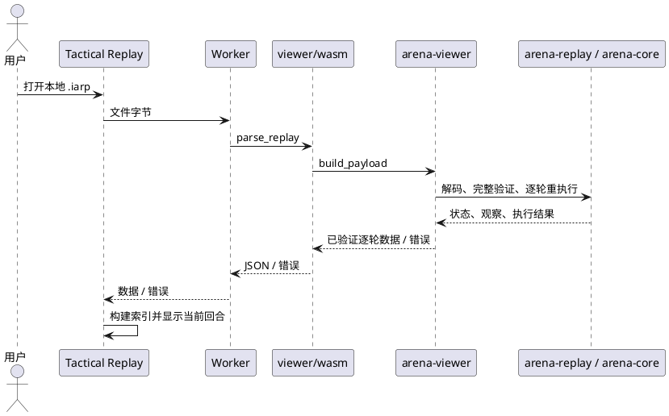

# Tactical Replay

Tactical Replay 是正式回放查看工具，位于 `viewer/app/`。浏览器直接读取本地 `.iarp`，完整验证后提供回合跳转、播放、视角切换、地图缩放、Agent 轨迹、Supply / Key 库存及命令结果。构建、操作与浏览器测试见 [前端 README](../../viewer/app/README.md)。

## 数据处理

`crates/arena-viewer/` 仅负责数据处理，依赖 `arena-core` 与 `arena-replay`。`viewer/wasm/` 是独立 Cargo workspace，隔离 wasm-bindgen 依赖；`viewer/app/` 负责显示和交互。

完整验证覆盖每轮哈希、得分增量、事件、提交处理结果及终局。第二遍重执行通过 `Observation` 构造逐轮状态，核对每轮哈希、双方公共观察一致性、累计得分与最终哈希。校验失败返回错误。

数据格式为 `ingress-viewer-v1`。`rounds[r-1]`、`agents[faction][r-1]`、`keys` 和 `commands` 对应 R 轮结算后状态；R0 来自 Header。得分以十进制字符串传输，前端使用 BigInt 保持精度。首次加载完成全量验证与物化，之后回合跳转直接访问内存快照。

IARP 包含双方私有信息；ENL、RES、PUBLIC 与 GOD 是显示视角，视角切换不改变原始归档的数据范围。

## 验证

`cargo test -p arena-viewer` 验证逐轮状态、得分、异常终局、损坏归档拒绝及遥测数据，并生成浏览器测试夹具。`viewer/app/` 的 `npm run build` 和 `npm test` 验证 WASM 构建、类型及浏览器行为，包括原生与 WASM 数据一致性和视角隔离。
