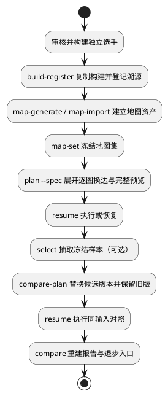

# 第二批：地图、赛事与版本对照

日期：2026-09-12。对应 [INFRA-03／04／05](iteration-infrastructure.md)，沿用 [第一批](iteration-batch-1.md)的执行隔离、恢复、重试资格及采用记录。规则、默认参数、官方计分与客户端协议均不改变。

## 一条可复用的开发流程



所有命令来自 `target/debug/arena-runner`（或 release 产物）。`cargo build --workspace` 可独立构建官方工具；server 不依赖任何 Bot 源码。新建资产文件、登记目录、赛事目录必须不存在；已有赛事使用 `resume`，不覆盖历史结果。

## 1. 登记冻结版本

先按 [构建溯源](../design/build-provenance.md)和 [审核边界](../adr/0005-mvp-runs-audited-source-built-by-operator.md)执行审核与构建，再提供登记请求：

```json
{
  "schema": "arena-build-request-v1",
  "entrant_id": "astra", "version": "v2",
  "binary": "../../astra_bot/target/release/astra-bot",
  "source_tree": "从审核构建记录复制的源码内容哈希",
  "commit": "提交号或 unknown", "dirty": false,
  "lock_hash": "锁文件内容哈希", "toolchain": "实际 rustc -Vv 文本或明确身份",
  "build_args": ["--release", "--locked"],
  "audit": {"status": "pass", "evidence": "审核结果全文或可追溯记录"}
}
```

```bash
arena-runner build-register --spec build.json --out builds/astra-v2
arena-runner build-inspect --input builds/astra-v2
```

相对二进制路径以请求文件所在目录为基准。登记保存 `binary`（独立字节副本，权限 0555）、`manifest.json`（二进制哈希及完整请求）、`identity`（清单内容身份）。不使用硬链接；源目录重新编译不会改变快照。赛事计划再复制一份到自身 `plan/builds/`，恢复与比较不依赖登记目录继续存在。

源码、提交、dirty、锁文件、工具链、构建参数和审核证据是**操作者记录的溯源事实**；登记器不代替审核、构建或验证源码到产物的对应关系。`audit.status` 为 `pass`、`fail`、`not-reviewed`；功能检查允许未审核夹具，timing／competition 要求记录为 pass，competition 还要求沙箱。未知值必须明确填写 `unknown`，不能把未知写成已验证。二进制哈希由工具自行计算，沿用 M9 域；旧 provenance 接口中的 toolchain_hash 由记录的工具链文本按 D71 域计算，未知值留空，原始文本仍在构建清单中。

文件只读及每次载入／启动前的内容校验防止误修改和混用，不抵御有权限改写档案、校验值或执行期间替换文件的同 UID 恶意操作者，也不构成密码学认证。保持登记目录与运行档案受控；不是运行任意不可信二进制的新许可。

## 2. 地图资产与地图集

规则 JSON 使用 `GameConfig` 的字段名和整数单位（cm、ms、round）。省略字段采用当前官方默认值，输出资产立即保存**所有字段的解析值**；随后不再重新应用默认值。未知字段、越界值和不合法地图会报错。

```json
{"portal_count": 60, "portal_cluster_count": 6, "total_rounds": 500}
```

```bash
arena-runner map-generate --config rules.json --layout uniform --seed 17 --out uniform.json
arena-runner map-inspect --input uniform.json
arena-runner map-preview --input uniform.json --out uniform.svg
arena-runner map-import --input manual.json --out imported.json
arena-runner map-export --input imported.json --out copied.json
```

`map-preview` 输出可本地打开的 SVG，保留地图比例与左下角原点，Portal 有编号提示。导入、导出均使用 `arena-map-v1` JSON；导出是标准化的完整定义，不是重新生成。

| layout | 布局约定（生成器 `arena-layout-v1`） |
|---|---|
| `uniform` | 全图均匀候选点 |
| `dense-clusters` | 三个固定锚点附近的紧凑簇 |
| `sparse-clusters` | 同样的锚点，使用更宽的簇范围 |
| `corridor` | 横向狭长走廊 |
| `edge-anchors` | 四条边附近的点带 |
| `symmetric` | 精确中心对称；奇数 Portal 另加中心点，要求尺寸为偶数 |

布局只改变计划阶段的候选坐标分布，不修改规则默认生成器或运行期 RNG。生成器种子、版本、layout、完整配置和标签随资产保存；有界尝试仍无法满足距离／数量限制时明确失败，不降级成另一布局。

人工地图示例（初始 Portal 全部中立且 HP 为 0，ID 按位置数组从 0 连续赋值）：

```json
{
  "schema": "arena-map-v1",
  "config": {"portal_count": 3, "portal_cluster_count": 1},
  "portals": [[0, 0], [90000, 0], [0, 90000]],
  "tags": ["manual", "triangle"],
  "source": {"kind": "manual", "note": "局部建场样本"}
}
```

输入可不填 `hash`；若填写必须与内容相符。输出总是保存完整配置和地图哈希。检查给出潜在邻接边数／可能边数（密度的整数分子与分母）、非退化可行三角数量及连通分量。邻接要求不超过 Link 距离、线段内部无其他 Portal；不考虑实际占领、Key、动态交叉 Link。无三角或图不连通是**质量提示**，不是非法地图，允许用于有意设计的测试。

地图集请求中的路径相对请求文件：

```json
{"schema":"arena-map-set-request-v1","purpose":"development","maps":["uniform.json","imported.json"]}
```

```bash
arena-runner map-set --spec set-request.json --out development.json
```

输出 `arena-map-set-v1` 嵌入所有地图，复制单个清单即可使用。`purpose` 为 development／regression／confirmation，三类应独立维护；工具不替开发者决定何时使用确认集。`content_id` 按排序后的“地图哈希＋配置身份”计算，与路径、标签和 purpose 无关，因此把开发地图换目录不能冒充全新内容。完全相同的地图＋规则不允许在同一清单中重复；不同规则作为不同分层输入。不同清单的内容身份相同意味着样本被复用，不会自动禁止有意复用。

## 3. 声明式赛事

```json
{
  "schema":"arena-event-v1", "name":"candidate-check", "seed":"42",
  "mode":"functional", "map_set":"development.json",
  "entrants":[
    {"id":"old","name":"Astra","build":"builds/astra-v1","args":[],"env":{}},
    {"id":"new","name":"Astra","build":"builds/astra-v2","args":[],"env":{}},
    {"id":"baseline","name":"Baseline","build":"builds/baseline-v1","args":[],"env":{}}
  ],
  "schedule":{"kind":"comparison","before":"old","after":"new","baselines":["baseline"],"repeats":2},
  "resources":{"workers":1,"per_match_budget_ms":600000,"sandbox":null,"address_space_bytes":536870912},
  "attempt_limit":3
}
```

```bash
arena-runner plan --spec event.json --out runs/check
arena-runner resume --out runs/check
arena-runner compare --out runs/check
```

`tournament --spec ...` 是计划并立即运行的快捷方式。赛事文件内的路径相对文件目录。`id` 是版本席位 ID（限字母、数字、下划线、短横线），同一赛事唯一；构建里的 `entrant_id` 是稳定选手身份；`name` 仅供展示，可以同名。回放显示登记名称与版本，稳定选手身份及实际构建哈希沿用第一批 IARP v2 链路。

`args` 是字符串数组，追加到 `<socket> <client_seed>` 后，不经 shell。`env` 仅允许既有沙箱白名单 `ARENA_`／`PROBE_` 前缀的变量，重复键拒绝。新赛事清空父进程环境，只保留固定 PATH 与声明变量（沙箱另外设置其 scratch HOME）；旧 CLI 保持原有兼容行为。相对运行参数路径以独立 scratch 为基准，不会自动复制策略依赖的数据文件。

支持三种 schedule：

| kind | 必需字段 | 每张地图每次重复的场数 |
|---|---|---|
| `round-robin` | `repeats` | 所有不同席位对各 2 场 |
| `challenge` | `candidates`、`baselines`、`repeats` | 每个候选×基线各 2 场，集合不得重叠 |
| `comparison` | `before`、`after`、`baselines`、`repeats` | 新旧版本分别与每个基线各 2 场；新旧必须为同一稳定选手 |

固定采用 `normal-only-v1`：正常比赛计入既有 Elo／胜平负，技术终止单独保存且不可依胜负重跑。比较采用 `paired-descriptive-v1`，正常胜平负记整数 2／1／0，仅用于差异摘要，不改变官方面积积分。

预览列出总场数、逐对阵逐图覆盖、A 在 ENL／RES 的数量、重复策略、每图尺寸／数量／距离／完整配置身份与标签、模式、并发、单场预算与沙箱。子集未覆盖的地图明确显示 `UNCOVERED`。单次计划最多 100000 场、重复次数 1..10000；尝试上限仍为 1..100。`functional` 表示功能验证，不是固定接收桶；`timing` 仍是实际外部进程时序；`competition` 要求审核和沙箱。地址空间预算仅在沙箱模式执行；未启用沙箱时不能把该声明解释为已生效。全机共享 CPU／内存协调和动态领取属于第三批。

每图使用资产保存的完整配置，含回合数及时间窗。预算过短会按第一批机制终止；选择合适预算是配置责任，不自动改变比赛规则或补跑胜负样本。

### 种子与配对

选手按席位 ID 排序，地图按内容身份排序；展示名、输出路径、workers、配置数组顺序不参与随机输入派生。地址为无歧义 JSON 数组：候选 ID、基线席位 ID、地图＋规则身份、master seed、repeat；comparison 的候选 ID 使用稳定选手身份而非版本席位。game／client 使用独立 `arena-event-*-v1` 域。map seed 只作生成来源记录，人工地图为 0，不用它恢复地图。

每个地址产生 ENL／RES 两个 leg，使用相同 game seed 和 client seed（双方客户端目前共用这个 client seed）；版本对照在相同 leg 间匹配。运行期随机仍带阵营／Agent 等索引，因此换边不承诺逐项随机结果相同；外部运行不承诺实际提交桶相同。冻结赛程中的具体种子为恢复事实源，不在恢复时再次派生。

## 4. 从已有计划抽样与替换版本

```bash
arena-runner select --from runs/check-baseline --items 0,1,4,5 --out runs/subset
arena-runner compare-plan --from runs/subset --candidate candidate --build builds/astra-v2 --out runs/paired
arena-runner resume --out runs/paired
arena-runner compare --out runs/paired
```

这两个入口只接受第二批冻结计划，始终创建**新的开发运行**；不改变来源赛事的采用结果，也不是对已完成胜负的 retry。`select` 按原顺序保存指定项，允许只取一场；新目录 index 重新连续编号，但原 tag／j、地图、规则、阵营、全部种子及 pair／leg 保持不变。

`compare-plan` 从单版本计划选取涉及候选的所有项，克隆 before 和 after；仅替换候选构建及登记版本／溯源，参数、环境变量、对手构建、地图、规则、阵营和种子不变。新席位为 `<candidate>-after`，冲突则拒绝。来源已是 comparison 时拒绝再次套用。两者都保存来源 plan manifest 内容哈希及操作类型。

## 5. 归档、兼容与报告

第二批新增 `plan/batch2.json`（模式、固定统计口径、地图集、完整地图规则、身份与 args、每项 pair／leg／variant）、`plan/builds/N/`（快照及溯源）。它们与第一批文件共同纳入 plan manifest；文件缺失、变动或清单漏项均拒绝载入。`plan/config.bin` 保留第一张地图的配置用于旧汇总接口；每场实际配置以 `batch2.json` 对应地图为准，schedule／单场元数据保存对应配置哈希。地图二进制与元数据交叉校验。

相对 build 路径在载入时以当前档案目录重新解析，归档迁移后无需保留原开发／登记路径；沙箱程序仍须由当前机器提供相应路径。第一批无 `batch2.json` 的档案仍可查询、恢复、重建，不自动迁移。旧命令的排程约定和可变二进制路径行为不变，新工作流应使用 `--spec`。

`compare` 验证已有尝试并重建采用／汇总，随后输出 `comparison.json` 和 `comparison.md`。报告包含逐场原始整数积分、对手×地图×配置分层、正常胜负改变、积分退步、技术终止／故障口径、双方漏交／结构拒绝／执行期 Drop 计数，以及实际尝试档案、执行 ID、二进制身份和回放链接。未形成回放的赛前失败保持 null，不伪造 IARP。

正常 before／after 才计算差值；`regressions` 专指 2／1／0 正常胜负积分降低，不代表所有面积收益或策略行为退步。原始面积积分完整保留。未完成、故障或技术终止的对照单独计数。首次状态差异（出生差异为 round 0）和首次命令内容差异用于定位，不能当作胜负因果证明。报告不输出置信区间，不把同地图换边／重复当作独立统计样本；内容来自冻结输入及采用证据，删除报告后可重建。第三批再提供观察历史恢复、策略 trace 和离线反事实。

验收证据见 [第二批记录](../reports/iteration-batch-2.md)。
