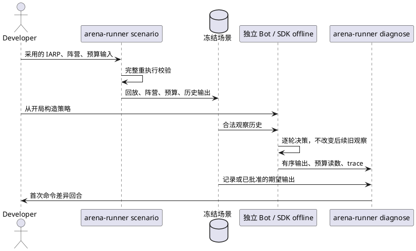

# 第三批：SDK 诊断、离线回归与动态调度

对应 [INFRA-06／08](iteration-infrastructure.md)，不修改 Alpha 规则、协议或 IARP 编码。第三批在第二批冻结地图、版本和执行档案上增加开发入口。验收证据见 [第三批记录](../reports/iteration-batch-3.md)。

## 1. SDK 反馈与共享策略

原有 `ClientBot` 无需改动。新增具有默认空实现的 `on_submission_feedback` 和 `on_round_timing`：

| 接口 | 含义 | 不能据此推断 |
|---|---|---|
| `SubmissionAck::Sent` | 本地完整帧写入成功 | 服务端接受或动作生效 |
| `SubmissionFeedback` | 服务端回执原始 round、Agent、结构／重复／迟到等状态和 detail | 接受后的每条命令一定执行成功 |
| `RoundTiming` | Context 准备及回调的墙钟耗时，逐次写入相对时间 | CPU 用时、权威接收桶 |
| IARP 重执行结果 | 官方 Resolver 对已记录输入的执行／Drop 结果 | 新策略输出在反事实世界的收益 |

回执按连接顺序在 `on_round` 返回后送入 Bot，包括最后一轮。回调不授予观察读取或修正重提权限；首份可定位提交冻结槽位的规则不变。旧 `Session::last_submission_result` 保留兼容，它没有 round 信息，不能作为新代码的跨轮回执接口。

`RoundContext::remaining_ms` 是本地估计，服务端截止时间仍权威。`callback_elapsed_us` 包括调度、阻塞和写入，不是纯算法计算时间。反馈／计时回调也在连接线程执行，应保持简短。

可选择使用 [strategy 模块](../../crates/arena-client-sdk/src/strategy.rs)：

- `Strategy::decide` 接收由官方视图生成的合法 `Observation` 和 `Decision`。不把敌方私有状态交给策略。
- `LiveStrategy` 将每次 `submit` 立即转发到 `RoundContext`，不会积累到轮末再整批提交；旧零拷贝接口仍可直接使用。
- `OfflineRound` 消费显式预算序列，预算耗尽返回错误，不偷偷读取真实时钟。提交最后一个己方 Agent 或 commit 后关闭输出。
- `HarnessStrategy` 接入 Core `MatchHarness`；双方都可在新结算状态上重新决策。其 bucket 是功能测试注入值，不是实测时序。
- 可选 `Trace` 保存 Agent、任务、目标、整数估值、策略声明耗时；每轮最多 1,024 条、任务和目标各最多 1,024 字节，只允许己方 Agent。在线预算读数最多记录 65,536 次。

## 2. 最小独立选手模板

[iteration-client](../../tools/iteration-client/src/main.rs) 是可构建的状态型开发模板，不是新竞争策略或平衡性基准。它读取服务端配置和地图，选择出生、逐 Agent 提交，声明 Bot 版本，并记录回执、计时和 trace。相同策略实现同时用于在线和离线。

在 server 根目录构建和运行：

```sh
cargo build --workspace
target/debug/arena-runner tournament --out /tmp/example-run --client target/debug/iteration-client --client target/debug/iteration-client --rounds 2 --fast
```

创建独立选手时，在 server 同级新建独立 Cargo 项目，复制模板源码，依赖 `../server/crates/arena-client-sdk` 和 `../server/crates/arena-core`，使用自己的 package 字段和锁文件，不加入 server workspace。离线入口需 SDK 的 `offline` feature；它增加官方 replay 和已有 blake3 依赖，在线策略本身不依赖 runner 或其他 Bot。

模板是非随机策略，明确忽略 client seed。随机策略必须在在线工厂和离线初始化中显式注入同一客户端 seed，不能用 IARP 的 game seed 代替。该模板不自动满足正式审核；发布时仍按 [第二批登记](iteration-batch-2.md)记录源码、产物、工具链及审核证据，正式赛事继续通过审核门槛与沙箱。

## 3. 从失败样本建立回归



```sh
target/debug/arena-runner scenario --input /tmp/example-run/matches/m0/attempts/0001/server/replay.iarp --faction enl --out /tmp/example-scenario
target/debug/iteration-client --arena-offline /tmp/example-scenario /tmp/example-decisions.json
target/debug/arena-runner diagnose --input /tmp/example-decisions.json --against /tmp/example-scenario/recorded.json
```

场景只写入新目录，包含 `source.iarp`、`faction`、`budgets.tsv`、`recorded.json` 和说明。复制目录即可使用，不依赖原比赛路径。`recorded.json` 是旧行为证据，不是要求永久复现错误：修复后将人工批准的新输出另存为 `expected.json`，后续版本再以 `diagnose --against expected.json` 检查，禁止自动覆盖期望。

`diagnose` 输出 `first_difference`，无命令差异为 null；它是诊断命令，发现差异仍返回成功，自动回归脚本应断言该字段为 null。输入回放身份、阵营、预算输入身份或观察历史不一致时拒绝比较。

`--budgets FILE` 可提供预算文档，首行为 `arena-budgets-v1`，其余每行是 `round<TAB>逗号分隔的 u64 毫秒值`。每个历史回合必须出现一次；空值表示策略不应读取预算。默认文档全为空，适合不依赖时钟的策略。在线 `on_diagnostics` 可记录预算读取序列，再显式构造输入；改变预算属于新的场景输入，不宣称精确复现实际时序。

`arena-decisions-v1` 保存规范化 IARP 内容哈希、预算输入哈希、阵营和逐轮信息：合法公共／己方私有快照的官方编码十六进制、按调用顺序的提交信封编码、旧输入接收时间与序号、己方已记录执行结果、预算读数和 trace。快照中的时间字段为零，是逻辑观察导出，不是伪造真实截止时间。执行结果的文字摘要供定位，权威数据仍在原 IARP 中。

复现边界：

- 默认从开局重建有状态策略；没有中途 Bot 状态快照契约，不提供隐式中途恢复。
- 只有声明的观察、初始化与注入预算决定输出的策略，才处于当前精确比较范围。IARP 不含完整 SDK 回执／回调时序；反馈驱动状态、外部文件、真实时钟或线程竞争策略需要额外显式输入契约，不能保证原输出一致。
- 输出比较保留提交顺序，忽略真实接收时间；commit 的传输行为与漏交、服务器补全不能仅凭命令内容完全判别。
- 固定旧观察的局部诊断不会将新命令送入世界，也不计算其反事实收益。双方重新决策的完整比赛应使用 Harness 或第二批外部赛事，必须分开标记。
- 整份 IARP 本身含比赛级赛后资料；仅 `Strategy::decide` 的输入与导出的 faction 快照保持观察边界。不得将离线档案作为正式比赛中的额外输入。

## 4. 动态调度与本机预算

持久化执行器与旧外部赛事库均改为动态领取任务。每个 worker 完成一项后领取下一项；结果、采用、汇总和 Elo 仍按冻结赛程顺序，改变完成顺序不改变逻辑身份。不承诺改变并发后外部比赛结果字节一致。

第二批 `resources` 可选增加以下字段：

```json
{"workers":4,"per_match_budget_ms":10000,"sandbox":null,"address_space_bytes":536870912,"cpu_slots":2,"memory_budget_bytes":"2415919104","host_pool":"/tmp/arena-host-pool"}
```

它是完整资源对象示例；`sandbox: null` 仅适合功能开发，不满足 competition 模式门槛。功能和实际时序测量使用第二批 `mode: functional`／`timing`，分别冻结规则窗口和预算；正式比赛为 `competition`。

有效并发为 workers、可选 cpu_slots、可选内存准入容量和可选主机槽位数的最小值。每场内存预留是两份客户端声明地址空间加 64 MiB 服务端／工具预留；不足以准入一场时在执行前报错。这是准入模型，不是实际 RSS 上界，64 MiB 不是服务端硬保证。

```sh
target/debug/arena-runner resource-pool --out /tmp/arena-host-pool --slots 2
target/debug/arena-runner preflight --out /tmp/frozen-event
target/debug/arena-runner resume --out /tmp/frozen-event
target/debug/arena-runner timing-report --out /tmp/frozen-event
```

资源池需先创建，所有合作运行器配置同一绝对路径。池目录及锁文件由操作者管理，不得在运行中替换／删除或改变容量。每场持有一个 OS 文件锁直到执行及归档结束；进程退出自动释放。等待槽位最多 60 秒，超时不新建 attempt，恢复后可再领取。不同资源池、未启用池的进程和非合作程序不受约束；未配置时预检明确要求操作者限制主机总并发。旧外部赛事库仅使用动态领取，本机池入口在持久化 CLI 工作流。

CPU 槽位不是绑核或 CPU 时间配额；批次内存不是 cgroup 硬限制。预检明确输出 `cpu_hard_enforced: false`、`batch_memory_hard_enforced: false`。已有每客户端沙箱限制照常使用，是否实际启用或降级须查看各 attempt 的 sandbox 报告，不能把当前未委派 cgroup 写成已解决。

## 5. 运行证据与兼容性

每次执行在 `executions/<随机ID>.json` 保存预检和主机条件；每个新 attempt 的 `resources.json` 分别保存预检、开始与结束时带时间戳的负载／内存快照，以及声明、有效容量、准入等待、起止时间及主机槽位，并进入已有 artifact 校验。这是点采样，不是连续性能剖析。旧 attempt 无此文件时保持可读。

`timing-report` 重建采用结果并写 `timing.json`，按赛程列出结局／异常原因、实际 attempt、可用回放的服务端实际接收毫秒、桶和序号、日志链接及 `ARENA_TIMING` 客户端声明。无 IARP 的异常 attempt 仍保留条件和日志。非 UTF-8 直接日志使用容错解码并标记，原始字节文件保留。模板提供结构化计时日志，其他选手可使用 `RoundTiming::to_json`。不支持或被截断的诊断不能当作零耗时；沙箱日志仍受原有保存上限限制。服务端到达延迟包含调度和传输，不能全部归因于算法。

第一、二批地图、构建、恢复、技术结果终局性与回放身份不变；Viewer 前端无需改动。新增工具不改变规则配置、协议消息或 IARP 版本。本轮不推进平衡性扫描。
