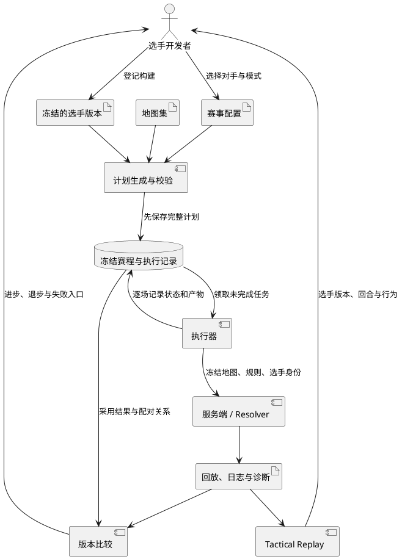

# Alpha 基础设施改进与交付计划

- 日期：2026-09-12。
- 状态：需求与建议已记录，待分批实施；本文不是已完成能力清单。
- 适用范围：server 的选手开发支持、地图资产、双阵营比赛调度、运行归档、比较分析与 Tactical Replay。
- 当前阶段与历史证据见 [开发进度](../progress.md)；规则语义仍以 [游戏规则](rules/README.md) 为准。

## 1. 背景与目标

Alpha 决策作出时，尚未开展工作区 `reports/` 下的后续分析。之后引入 Astra 等多个独立 Bot，再开展策略比较、回放审查和参数实验，是在落实“由独立选手提供新策略和反例”。后续分析与 [Alpha 决策](../design/alpha-reference.md#决策依据与适用范围)具有连续性。

当前暂保留 Alpha 默认规则。B5 保留历史未完成状态，不作为基础工程改进或新一轮选手迭代的前置条件。只有独立选手暴露具体规则风险，或形成明确的参数采用问题时，再启动针对性规则验证。

本轮工程目标是让选手能够自行完成以下流程，并取得可追溯、可解释的反馈：登记构建版本，选择地图和对手，执行可复用赛程，恢复中断任务，比较版本表现，定位失败回合，建立行为回归。

| 目标 | 可观察的交付结果 |
|---|---|
| 选手自主迭代 | 新旧版本比较和失败定位可以通过官方入口完成，无需为每次实验编写专用运行程序 |
| 多样化地图 | 同一赛事可以使用冻结地图集，覆盖多种结构，并明确每张地图的实际出场次数 |
| 多选手调度 | 支持循环赛、候选版本挑战基线集、逐图配对换边，并保留完整排程和执行记录 |
| 可恢复的执行 | 批次中断后可以恢复；补赛保留原始尝试，采用结果可重新汇总 |
| 易于理解的回放 | Viewer 能显示双方选手名和版本，并关联实际阵营、构建身份与诊断信息 |

每场比赛仍为两个阵营之间的对局。“多选手”指赛事中的参赛集合与排程，不扩展单场阵营数量。

## 2. 范围与工程边界

- server 保持独立构建和测试，各 Bot 保持独立仓库。官方工具消费选手产物和公共接口，server 不依赖具体 Bot 策略源码。
- 优先交付单机本地工作流。分布式执行、在线托管平台和训练系统不进入首轮交付。
- 规则结算、回放验证继续共用官方 Resolver；地图生成与离线统计属于非权威工具，比赛使用已校验的冻结输入。
- 功能验证、实际时序测量和正式比赛须标明运行模式。固定桶结果不能替代实际时序结果，改变并发也不承诺外部比赛结果逐字节一致。
- 历史实验和回放保留原始口径。提取 `reports/` 中的通用能力时，以官方接口重新组织；原有报告、种子和统计定义不随工具升级改写。
- 公共错误类型、输入校验和边界测试随本轮涉及模块补齐；不以全面重构既有核心引擎作为前置工程。

## 3. 当前能力与缺口

以下为本轮梳理时的实现事实。已有能力应复用，不能因缺少 CLI 入口而误记为底层完全不存在。

| 范围 | 已有能力 | 当前缺口与证据 |
|---|---|---|
| 执行隔离 | 单批次内按赛程项隔离，具有沙箱和赛后阵营证明 | 比赛 ID 由赛事名称与 index 拼接，跨批次可能重名；SHM 将重名直接当作残留清理。见 [执行器](../../crates/arena-runner/src/tournament/exec_external.rs)、[SHM](../../crates/arena-server/src/shm.rs)及[实际撤回记录](../../../reports/astra-selfplay-balance-20260911/external-recovery-protocol.md) |
| 批次恢复 | 单场回放、日志、结局分类与批次归档 | 主 CLI 在整批运行后写计划与汇总，缺少正式恢复和补赛入口。见 [CLI](../../crates/arena-runner/src/main.rs)、[执行流程](../../crates/arena-runner/src/tournament/run.rs) |
| 赛事配置 | 库支持选手、指定对阵、环境变量、并发和完整规则配置 | CLI 主要提供所有选手两两对战；地图池大小不等于逐图覆盖，阵营总量平衡不等于逐图配对。见 [赛程生成](../../crates/arena-runner/src/tournament/schedule.rs) |
| 地图资产 | `MapDefinition`、人工构造、合法性校验及 IARP 完整地图 | 外部服务端仍从 seed 生成地图，缺少冻结地图集导入路径。见 [地图模型](../../crates/arena-core/src/map.rs)、[服务端入口](../../crates/arena-server/src/driver.rs) |
| 版本比较 | 二进制哈希、可选溯源字段、Elo 和阵营汇总 | CLI 使用外部可变二进制路径；冻结构建、保留旧版本和同输入比较主要靠实验脚本。见 [选手模型](../../crates/arena-runner/src/tournament/entrant.rs)、[新旧版本实验入口](../../../reports/tools/arena-analysis/src/bin/paired-before.rs) |
| 开发反馈 | SDK、Core Harness、已验证的逐轮命令结果 | 无沙箱执行丢弃客户端标准输出和错误输出；沙箱仅保留有限输出；SDK 与离线策略接口不同，提交回执未直接暴露到常规 Bot 回调。见 [SDK](../../crates/arena-client-sdk/src/round.rs)、[Harness](../../crates/arena-core/src/harness.rs) |
| 回放身份 | `ClientHello` 已有 `client_name`、`client_version` | 服务端日志记录名称，但握手处理未保留客户端版本；IARP 没有选手身份字段，Viewer 顶部显示阵营名称。SDK 默认客户端版本为 `sdk-*`。见 [协议](../../crates/arena-protocol/schemas/protocol.fbs)、[SDK 握手](../../crates/arena-client-sdk/src/client.rs)、[IARP](../../crates/arena-replay/src/format.rs)、[Viewer](../../viewer/app/src/main.ts) |
| 并发与计时 | worker 并发、超时处理、资源限制与降级记录 | 固定步长任务分配缺少动态领取，多进程运行没有统一并发预算；运行负载与策略耗时需要分开解释。见 [运行器](../../crates/arena-runner/src/tournament/run.rs)、[实际时序分析](../../../reports/astra-selfplay-balance-20260911/runtime-results.md) |

例如，当前 `--maps 10 --matches 2` 为每个对阵安排两场，实际只使用地图池的前两张；选手名单的索引还参与对阵标签生成。新的接口必须让覆盖范围和输入身份可直接检查。

## 4. 工作流与身份模型

以下对象定义必要语义，具体编码与公共接口在对应交付切片中确定。

| 对象 | 身份与职责 |
|---|---|
| 选手 | 稳定的参赛者 ID 与展示名；展示名、自报名称和阵营分别保存 |
| 选手版本 | 不可变构建、策略版本、参数、源码与依赖溯源；同一选手可以登记多个版本 |
| 地图资产 | 完整 Portal 定义、内容哈希、生成来源、结构标签及相容配置 |
| 赛程项 | 冻结的逻辑比赛；记录地图、规则、阵营映射、游戏种子、客户端种子和对照关系 |
| 执行实例 | 某赛程项的一次运行尝试；每次具有新的运行身份及独立资源名称 |
| 采用记录 | 将赛程项关联到被采用的执行结果，保存替代原因和历史尝试 |
| 分析报告 | 对选定采用记录生成的可重算产物，携带分析版本和样本口径 |

修改选手展示名、输出目录或并发数，不应悄悄改变已冻结的逻辑输入。新旧版本比较允许替换明确声明的版本字段，其余输入按配对约定保持一致。

## 5. 改进需求

### INFRA-01 比赛实例隔离与阵营绑定

- 为每次执行分配唯一实例身份，SHM、socket、工作目录和进程监督均使用该身份；逻辑赛程 ID 不直接充当操作系统资源名称。
- 活跃实例资源发生冲突时拒绝启动。残留清理须检查归属与存活状态，不能仅凭重名删除。
- 建立服务端确认的连接就绪与阵营绑定流程。首个切片可采用服务端就绪屏障；若扩展接入协议，应把凭据与预期赛程席位绑定。
- 保留实际连接与赛程映射的赛后核验；展示名称不能代替身份认证。
- 身份元数据分别记录计划阵营和实际绑定结果，无法证明对应关系的比赛不得作为预定赛程项计分。

验收 `A-INFRA-01`：两个同名批次在不同目录并发执行、同一赛程项多次尝试和异常终止后的恢复均不串用资源；重名冲突不会破坏活跃比赛；计划与实际阵营一致，并覆盖故障拒绝路径。除回放验证外，检查客户端读取的实例身份与观测归属。

### INFRA-02 可恢复执行、日志与采用记录

- 启动任何比赛前，保存已解析的完整赛事配置、冻结地图、选手版本引用和展开赛程。
- 任务至少区分待运行、运行中、完成、基础设施故障和中断；Bot 技术判负属于已产生的比赛结果，不能简单当作运行器故障。
- 每场完成后立即原子保存结果、验证状态和产物索引。恢复时校验已有产物并处理未完成项；每次尝试使用独立目录。
- 提供计划预览、进度查询、恢复、指定故障重试和重建汇总入口。重试资格、次数上限和采用规则在执行前确定，不能依比赛胜负选择重跑。
- 每方分别采集 stdout、stderr、退出状态、沙箱报告和可选诊断输出。持续排空输出，设置存储上限并明确截断，避免日志反压阻塞客户端。
- 日志和元数据写入失败进入显式故障状态。积分、Elo 与报告由采用记录按冻结赛程顺序重新计算，避免重复计分。

验收 `A-INFRA-02`：批次在若干比赛完成后被中断，恢复可以复用已验证完成项；一次故障补赛同时保留原始结果及采用理由；重新生成汇总与采用清单一致。高输出客户端不阻塞比赛，日志截断可识别，存储失败不被静默忽略。

### INFRA-03 声明式赛事与可复用排程

- 提供版本化配置文件，描述命名选手及版本、允许的参数与环境变量、地图集、对阵、重复次数、运行模式和资源预算。启动参数使用结构化字段。
- 首批支持全体循环赛、候选版本挑战指定基线集、逐图配对换边。正式赛制的单场计分与开发对照的配对分析分别声明。
- 计划预览须显示总场次、每个对阵的地图覆盖、阵营分配、重复次数和资源预算；未覆盖地图须显式提示。
- 冻结赛程可以重新载入、选取子集和用于新旧版本对照，避免依赖重建原始 CLI 参数或保留旧 entrant 数组索引。
- 明确记录地图、游戏和客户端随机输入的派生约定。配对不自动声称各阵营获得逐项相同的随机结果，更不承诺实际接收桶相同。

验收 `A-INFRA-03`：至少三名选手的循环赛和候选挑战均能从配置生成；逐图换边的每个配对可检查；重命名展示字段、调整配置中的选手排列不改变已冻结样本；取出一项重跑不改变其逻辑输入。

### INFRA-04 地图资产与地图集

- 为外部服务端和运行器提供完整地图输入。地图生成在计划阶段完成，执行和回放使用相同冻结定义。
- 提供生成、导入、导出、校验、预览和地图集清单入口，记录内容哈希、生成器版本、生成参数和结构标签。
- 地图集支持多种布局及每图相容配置，包括尺寸、Portal 数量和距离约束。配置差异在计划与报告中可见。
- 首批布局覆盖均匀分布、密集簇、稀疏簇、走廊、边缘锚点和对称布局；允许导入人工制作的合法地图。
- 生成邻接密度、可行三角数量、连通分量等结构摘要。合法性错误阻止执行，极端结构及缺少建场机会等质量信号单独标注，允许作为有意设计的测试样本。
- 开发集、回归集和后续确认集使用独立清单与内容身份，避免仅凭目录名或 seed 标签判断是否重复使用地图。

验收 `A-INFRA-04`：人工地图和至少两种生成布局可通过同一外部比赛入口执行；计划、服务端和 IARP 中的地图内容一致；旧冻结地图不随生成器升级改变；非法输入在启动比赛前返回具体错误。

### INFRA-05 选手版本登记与比较分析

- 登记不可变二进制和明确的选手版本，关联源码内容身份、提交及工作区变更状态、锁文件、工具链、构建参数和审核结果；自报版本与实际构建哈希分别记录。
- 执行已登记的构建快照，校验实际产物与登记身份一致，避免开发者重新构建后同一批次混用版本。
- 提供同一选手新旧版本挑战冻结对手集的入口，复用地图、阵营、种子和对照关系；可以只执行需要的对阵。
- 输出机器可读逐场记录和人类可读报告，包括对手矩阵、逐图差异、胜负改变、退步样本、漏交和非法动作等。Elo 保留为赛事汇总之一。
- 报告明确样本数、故障与技术判负口径、地图分层和运行模式；涉及统计区间时按地图关联处理，保留原始整数数据及分析版本。
- 每个异常或退步样本链接到实际采用档案和回放。首次状态或命令分歧用于定位，不能自动当作后续胜负的唯一原因。

验收 `A-INFRA-05`：新旧版本对固定对手集完成同输入比较，任取结果可追溯到实际二进制、完整配置和回放；开发目录中的重新构建不改变已登记产物；仅由归档即可重建比较结果与样本清单。

### INFRA-06 SDK 反馈、离线复现与回归

- 提供最小独立选手模板和开发说明，覆盖配置读取、分阶段提交、日志、版本声明、审核及单场运行。
- 向常规 Bot 接口提供带 round、agent 和状态的提交反馈，保留第一份提交冻结槽位的规则。接收或结构回执与执行期命令结果须分别表达。
- 标明 SDK 本地剩余时间的估计性质，分别记录规划耗时、提交时间及服务端实际接收桶。
- 提供 SDK 与离线 Harness 的测试适配能力，让同一策略实现消费合法观察并产生有序提交；支持提前提交和可注入预算，避免测试接口强制改变正式策略的提交方式。
- 提供从归档恢复观察历史、比较策略输出和定位首次差异的官方入口。有状态 Bot 默认从开局恢复；中途恢复须有显式 Bot 状态快照契约。依赖时钟的策略须记录或注入相应预算输入，并说明可复现范围。
- 支持将典型失败转成可重复场景与回归用例。使用旧观察或固定敌方命令的局部反事实，须与双方重新决策的完整比赛分别标记。
- 可选策略 trace 记录回合、Agent、任务、目标、估值和耗时，与官方命令及实际结果关联；诊断数据作为附属档案，遵守原有观察边界。

验收 `A-INFRA-06`：独立示例选手能用同一策略实现完成 SDK 对局与离线测试；一个有状态策略可按声明范围重建历史输出并定位差异；回执关联正确；一次失败可以形成回归用例。实时提交的行为不能因接入测试适配器而被强制改成整轮批量提交。

### INFRA-07 Replay Viewer 显示选手名与版本

这是本轮新增的明确需求。打开一份新生成的 `.iarp`，应直接知道双方是谁、分别运行哪个版本，以及各自属于 ENL 还是 RES。

#### 身份来源与版本语义

| 信息 | 来源与要求 |
|---|---|
| 注册选手 ID、展示名 | 运行器的参赛登记；独立启动服务端时允许缺省 |
| 注册 Bot 版本 | 冻结选手版本中的策略或发布版本；与二进制身份关联 |
| 客户端自报名称 | 保存 `ClientHello.client_name` 原值，不用于认证赛程身份 |
| 客户端自报版本 | 保存 `ClientHello.client_version` 原值；`sdk-*` 默认值只表示客户端 SDK 版本，不能自动当作 Bot 策略版本 |
| 实际构建身份 | 运行器登记并验证的二进制哈希，可附提交、源码身份等溯源信息 |
| 阵营归属 | 使用服务端确认的实际映射，并保存赛程绑定核验状态 |

SDK 应提供明确的 Bot 版本声明方式及示例，使独立启动的选手也能上报自身版本；策略版本、客户端版本和 SDK 版本的语义必须可区分。具体字段扩展与编码在实施设计中确定。

注册信息存在时，以注册展示名和 Bot 版本作为主要标签；自报信息单独保留供查看。缺少注册信息时回退到自报名称和明确声明的 Bot 版本；无法确定策略版本时显示“版本未知”，不能从文件名或 SDK 默认值猜测。

#### 归档与展示

- 身份信息经服务端绑定后进入回放元数据，贯通 Recorder、解码器、`arena-viewer`、WASM 和前端。新生成的回放只需单个 `.iarp` 文件即可显示身份，不依赖同目录 `meta.json`、日志、文件名或在线查询。
- 采用版本化 IARP 元数据扩展，明确格式兼容策略；不能向当前严格格式随意追加未定义内容。身份信息随归档保存和校验，不参与游戏状态哈希或改变计分。
- 新解码器继续支持既有可支持规则版本的旧回放；旧文件缺少身份时显示阵营名及“选手未知／版本未知”。未知格式或不受支持的规则版本明确报错。
- 顶部双方比分区域显示选手名、Bot 版本和 ENL／RES 标识；比赛详情展示完整版本、自报信息和可用构建身份。同名不同版本必须可区分。
- 长名称、Unicode 和特殊字符按纯文本显示；截断时仍能查看完整内容，窄屏下保留阵营和双方身份的可辨识性。
- 若注册信息与自报信息不同，应保留来源，不能静默覆盖。回放规则验证不等于证明客户端自报信息真实；缺少核验的身份不能显示为已认证构建。
- 元数据在跨轮跳转和视角切换时保持稳定，加载另一份回放时完整替换。已存在的异常或零轮回放按实际可用元数据显示；尚未形成 IARP 的赛前失败通过执行归档查询，本需求不要求伪造回放。

验收 `A-INFRA-07`：注册比赛和独立启动比赛均覆盖名称与版本显示；包含新旧版本同名对战、缺失版本、旧 IARP、自报与注册信息不同、长名称、Unicode、异常回放及连续切换文件。原生与 WASM 解码身份字段一致，浏览器显示与实际阵营对应，单文件复制后仍可查看身份。

### INFRA-08 动态调度与运行测量

- 使用动态任务领取替代固定步长分配，结果身份和计分顺序仍按冻结赛程确定。
- 提供批次 CPU、内存和并发预算及运行前检查；记录可用与实际生效的隔离能力，已有 cgroup 环境限制不得写成已解决。
- 多个运行器共享主机时，提供可配置的本机资源协调或明确的总并发约束，避免各批次分别认为自己独占主机。
- 分别提供功能验证与实际时序测量配置。记录负载、客户端规划耗时和服务端接收桶，不能把 wall-clock 延迟全部归因于算法计算。
- 用受控短长任务组合验证调度收益，用真实外部运行验证资源与计时行为；功能测试中的固定桶不替代这些检查。

验收 `A-INFRA-08`：短长任务混合时可继续领取剩余任务，预算得到执行或明确记录降级；改变完成顺序不改变结果归属与汇总顺序；实际时序报告显示测量条件，外部比赛结果差异得到保留。

## 6. 建议交付节奏

按三个批次逐步形成可用工作流，不预设未经估算的工期。每个批次中的切片应可独立验收，完成后即可供选手使用。

| 批次 | 交付切片 | 完成后的使用方式与验收重点 |
|---|---|---|
| 第一批：可信且可恢复的执行 | 1A 实例隔离、连接确认、身份采集；1B 计划先落盘、逐场结果、恢复与补赛；1C 基本客户端日志和完整名称／版本回放链路 | 同名批次可并发，任务可恢复，故障有证据；新 `.iarp` 能直接显示双方名称和版本。通过 `A-INFRA-01`、`02`、`07` |
| 第二批：地图、赛事与版本对照 | 2A 完整地图输入和地图集；2B 声明式配置、覆盖预览及配对排程；2C 冻结构建与新旧版本比较 | 一份配置即可让候选版本挑战固定对手集，覆盖不同地图类型并取得差异报告。通过 `A-INFRA-03`、`04`、`05` |
| 第三批：深入诊断与运行效率 | 3A SDK 回执和计时反馈；3B 离线复现、场景回归及 trace 关联；3C 动态任务领取和资源协调 | 从退步样本定位到具体回合及策略行为，形成回归；多批次运行的资源和时序可解释。通过 `A-INFRA-06`、`08` |

Viewer 名称与版本展示安排在第一批，身份采集与回放兼容设计先于界面改动。注册构建溯源在第二批完善后，复用同一身份模型补充信息，不替换第一批已经归档的来源记录。

第一、二批是启动下一轮常规选手迭代的优先准备范围。基本日志随第一批交付，复杂策略 trace 与离线适配在第三批完善；不因诊断工具尚未全部完成而阻止使用已通过验收的工作流。

## 7. 端到端验收与测试范围

最终以一个可重复的开发任务验收：登记某选手的新旧两个版本及至少两个独立对手，选择至少两类地图，生成逐图换边的对照计划，执行期间模拟中断和一个基础设施故障，恢复后生成版本差异报告，打开一个退步样本并定位行为。

应同时满足：

1. 已完成且验证通过的赛程项可复用，补赛不覆盖原尝试，也不重复计分。
2. 任意采用结果可追溯到地图内容、规则、阵营、种子、实际构建和执行实例。
3. 每张计划地图的覆盖情况可核对，输入不依赖 CLI 数组位置或输出目录名。
4. 报告能指出具体进步、退步和运行异常，链接实际采用回放。
5. 仅复制一份新 `.iarp` 即可显示双方名称、版本和阵营；旧回放继续按缺省身份显示。
6. 同名批次并发和异常恢复不造成观测串局；回放内部一致性与观测归属分别检查。
7. server 可独立构建测试，验收选手通过外部产物接入。

测试随切片覆盖受影响边界：赛程与采用规则使用确定性测试，实例隔离、日志、连接和恢复使用真实进程集成测试，地图导入覆盖非法与极端输入，回放格式覆盖历史夹具与损坏输入，Viewer 使用原生／WASM 一致性及浏览器测试。实际时序检查记录主机负载和资源配置，不用脆弱的绝对毫秒阈值替代语义断言。

实现期间在 [progress.md](../progress.md) 更新批次状态与证据链接。涉及接入协议、IARP 编码或持久化格式的具体决定，在对应切片中补充设计与兼容说明；本文规定需求和交付结果，不把尚未实现的方案标记为验收通过。
