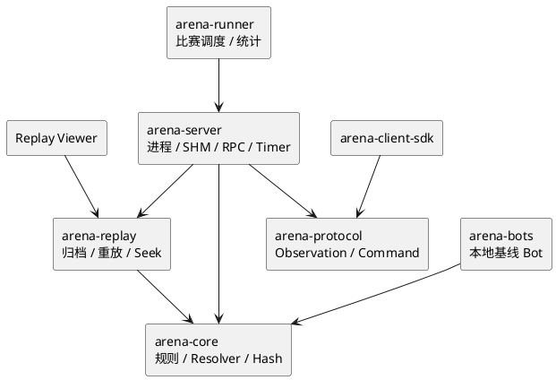

# 架构与模块边界

> 本文保留 MVP 实施时的架构布局。Alpha 已将参赛策略移至同级独立 bot 仓，server 不再包含 `arena-bots`／`bots/`；当前职责与接入方式见 [Alpha 迁移记录](../../design/alpha-reference.md) 和 [server README](../../../README.md)。

## P-ARCH-01 工程原则

| 优先级 | 原则 | 约束 |
|---|---|---|
| 1 | 先规则，后基础设施 | Core 可让两个本地 Bot 完赛前，不建设账号、云部署或公开匹配 |
| 2 | Server 是唯一权威状态源 | Client 只执行 `Read Observation → Compute → Submit Commands`，不得修改状态或 RNG |
| 3 | 确定性优先 | MVP 规模小，优先级为 Determinism > Correctness > Debuggability > Performance |
| 4 | Core 与 Runtime 分离 | 网络、进程、共享内存和计时不能进入纯游戏逻辑 |
| 5 | 可见性靠边界保证 | SDK 和 OS 映射只暴露该阵营可见数据，不能只靠调用约定隐藏字段 |

## P-ARCH-02 组件关系



`arena-core` 不依赖网络或操作系统；它包含 geometry、map、portal、agent、action、resolver、field、scoring、rng、event，以及生成 Replay 记录和 Canonical State Hash 所需的纯逻辑。State Hash 使用 `BLAKE3-256`，不得直接哈希 FlatBuffers Buffer。存储、进程和展示分别留在边界组件。

## P-ARCH-03 Rust 实现边界

MVP 的权威 Game Core、Server、Runner、Replay、官方 SDK 和 Baseline Bots 使用 Rust。Viewer 不受此决定约束；对外协议和 Replay 格式必须语言无关，不得暴露 Rust ABI。协议 Payload 与 SHM Snapshot 使用 FlatBuffers Schema，v0.1 只正式提供和验收 Rust SDK，未来可在不修改比赛协议的前提下增加其他语言 SDK。决策背景见 [ADR-0001](../../adr/0001-rust-mvp-language-neutral-protocol.md) 与 [ADR-0009](../../adr/0009-flatbuffers-for-protocol-and-shm.md)。

推荐 Workspace 如下：

| 路径 | 职责 |
|---|---|
| `crates/arena-core` | 权威数据模型与纯确定性结算 |
| `crates/arena-protocol` | FlatBuffers Schema、生成绑定与版本化消息 |
| `crates/arena-server` | Runtime、计时、SHM/RPC 和进程管理 |
| `crates/arena-client-sdk` | 参赛者 API，只暴露合法观察 |
| `crates/arena-bots` | Random、Nearest、Greedy、DestroyAnchor、Hybrid |
| `crates/arena-runner` | 批量比赛、Map Set、统计与排名 |
| `crates/arena-replay` | Replay 编解码、校验与 Checkpoint |
| `viewer/` | Replay UI |
| `bots/` | 独立 Client 示例与基准实现 |
| `tools/` | Replay CLI、Benchmark 和统计工具 |

## P-ARCH-04 SDK 边界

Client SDK 不暴露 Server 内部对象。本地 Bot 与外部 Client 复用同一套协议数据模型；SHM、有序消息、时钟及必要 FFI 只在 SDK 内部实现，参赛者 crate 不直接接触这些能力。MVP 的 `ObservationView<'round>` 是 FlatBuffers `PublicSnapshot` 与己方 `PrivateSnapshot` 上的零拷贝只读 View，而不是 Client 私有副本；布局由独立 Schema 与版本字段定义，不使用 Rust ABI。核心接口概念保持精简：

```rust
trait Bot {
    fn on_round(&mut self, round: RoundContext<'_>);
}
```

`RoundContext` 同时封装零拷贝 Observation 与逐 Agent 提交能力。View 不能存入 Bot 长期状态或交给 Detached Thread；Scoped Worker 必须在 Context 关闭前 Join。提交最后一个 Agent Stream、显式 Commit 或 deadline 都会关闭 Context，之后 SDK 拒绝新的借用与提交。`ObservationView` 只包含 [`R-VIS`](../rules/05-visibility-resolution-rng.md) 允许该阵营读取的信息。

进入 Round 循环前，SDK 通过独立的赛前初始化回调向 Bot 提供完整地图，并一次提交覆盖全部初始 Agent 的 Initial Spawn Set；该路径不复用或模拟批量动作接口。

Runtime 中每个 Client 只建立一条持久化全双工 Unix Domain `SOCK_STREAM`；`u32` 大端长度前缀负责 framing，SDK 串行写帧。该连接同时承载赛前、Round 控制和动作消息，详见 [ADR-0008](../../adr/0008-single-ordered-unix-stream-per-client.md)。

FlatBuffers Schema 至少定义 `ProtocolEnvelope`、`PublicSnapshot` 与 `PrivateSnapshot` 根类型。MVP 要求 Client 与 Server 的 Protocol、Public Snapshot 和 Private Snapshot 版本全部精确相等，不做兼容协商。所有 Client 输入先经 Verifier，再转换为 Core 自有的权威类型；SDK 也在暴露新 SHM View 前验证 Server 发布的 Buffer 与 Schema 版本。Verifier 只扫描字节，不把 Snapshot 复制成 Client 私有对象。

Core 使用 `Coord(i32)` 表达坐标，合法值由非负闭区间 `MAP_WIDTH × MAP_HEIGHT` 约束；所有几何运算在减法前先提升到 `i64`，`Area2` 使用 `u64`，累计 `Score2` 使用 `u128`。全部运算 Checked，禁止依赖 Release 模式 Wrapping 或 Saturating；`GameConfig` 在比赛创建时验证数值上界。详见 [ADR-0007](../../adr/0007-fixed-width-integer-game-math.md)。

## P-ARCH-05 MVP 前置范围外

在 Core 和 Self-play 验证完成前，不投入 Web Account、Authentication、Cloud Deployment、Public Matchmaking、Spectator Server、复杂 UI、永久排行榜、LLM API Integration、分布式 Server、数据库集群或复杂 Anti-Cheat。v0.1 也不接受闭源或参赛者提供的预编译 Client 二进制。
