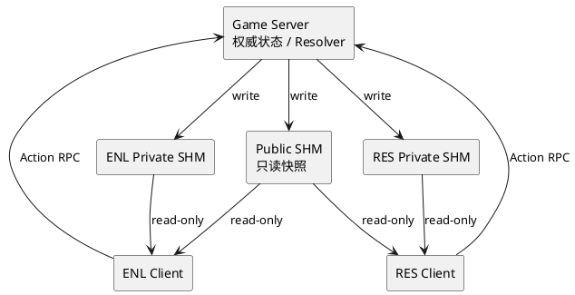

# P3—P4：外部 Runtime 与 Sandbox

仅在 Simulator 玩法基本稳定后，把本地 Bot 替换成两个独立 Client 进程；随后再加入正式比赛需要的资源与信息隔离。

## P3 进程与通信边界



Shared Memory 承担 Server → Client 的高频零拷贝只读 Observation；有序本机消息连接承担控制、动作与提交结果。两条路径均使用 FlatBuffers Schema，不把双方私有状态放入同一映射后只靠 SDK 隐藏字段，也不依赖 Rust ABI。详见 [ADR-0009](../../adr/0009-flatbuffers-for-protocol-and-shm.md)。

## P3-SHM 快照分区与双缓冲

| 分区 | 内容 | Client 权限 |
|---|---|---|
| Public SHM | Public State、公开事件、`current_round`、`snapshot_version`、`round_start`、`deadline` | ENL / RES 只读 |
| ENL Private SHM | ENL Agent 私有状态 | 仅 ENL 只读 |
| RES Private SHM | RES Agent 私有状态 | 仅 RES 只读 |

每个分区分别保存一个带 Schema 版本的 FlatBuffers 根对象，并使用 Snapshot A/B 双缓冲。Round N 时 Client 读取 A，Server 写 B；Server 完成构造和验证后，以原子元数据一次发布 `current_snapshot = B`、`snapshot_version`、`current_round`、`round_start` 和 `deadline`。下一轮角色互换；SDK 验证新 Buffer 后才借出 View，遵守阶段协议的 Client 不会读取 Server 正在修改的缓冲区。

## P3-RPC 最小协议

每个 Client 只允许一条持久化、全双工 Unix Domain `SOCK_STREAM`。所有消息使用 `u32` 大端 Payload 长度前缀，Payload 是以 `ProtocolEnvelope` 为根的 FlatBuffers Buffer；长度不含前缀本身，且硬限制为 `MAX_FRAME_PAYLOAD_BYTES = 65_536`。解码器必须在分配 Payload 前检查上限；超限时不排空帧而直接关闭连接，开赛后产生 `CLIENT_FORFEIT`。上限内的完整 Buffer 若 Verifier 失败，则作为可恢复的信封拒绝。SDK 串行写入完整帧，不允许通过多个连接并发提交。Server 在完整帧结束时记录 `received_at`，并依连接帧序分配 Faction `receive_seq`；随后通过 FlatBuffers Verifier 才读取 Envelope。详见 [ADR-0008](../../adr/0008-single-ordered-unix-stream-per-client.md)。

| 消息 | 方向 | 关键字段 / 语义 |
|---|---|---|
| `CLIENT_HELLO` | Client → Server | Client 构建身份及 Protocol、Public Snapshot、Private Snapshot 版本 |
| `SERVER_HELLO` | Server → Client | 精确版本匹配后的 Match / Faction 身份确认，或启动中止原因 |
| `INITIAL_SPAWN_START` | Server → Client | 双方认证后通知完整地图已原子发布，并许可读取赛前 Map View |
| `SUBMIT_INITIAL_SPAWNS` | Client → Server | 赛前一次提交该方完整 `agent_id → coordinate` 集合；首个信封合法集合冻结，整体校验，不参与 Priority Bucket |
| `INITIAL_SPAWN_RESULT` | Server → Client | 接受，或导致 `SPAWN_FORFEIT` 的私有拒绝原因；不可触发替换 |
| `ROUND_START_SIGNAL` | Server → Client | 无权威 Round 载荷；通知新快照已发布，并许可 Client 恢复读取 SHM |
| `SUBMIT_COMMAND_STREAM` | Client → Server | `round_id` 和一个 Agent Command Stream；以完整帧最后一字节到达 Server 的单调时刻计时 |
| `SUBMISSION_RESULT` | Server → Client | 首个 Stream 的 accepted / rejected 状态，或重复提交被忽略的私有原因；均不可触发替换 |
| `COMMIT_ROUND` | Client → Server | `round_id`；不可撤销地把该方未提交 Agent 冻结为空过 |
| `ROUND_CLOSED` | Server → Client | 输入已关闭并进入 Settlement Phase；Client 必须停止读取 SHM |
| `GAME_END` | Server → Client | 正常 Game Result 或技术性 Match Outcome，以及可公开元数据 |

Schema 必须显式版本化。Server 在发布地图前要求双方 `CLIENT_HELLO` 中的 Protocol、Public Snapshot 和 Private Snapshot 版本与赛事版本精确相等，不执行前向、后向或能力协商；不匹配即中止启动，归类为构建 / 赛事基础设施错误，不产生 `SPAWN_FORFEIT`，也不进入 Elo。握手成功后的消息还必须明确大小、命令数量、认证 Faction、Agent 归属、赛前原子出生集合、信封校验、按 Agent 独立提交、首个提交冻结、重复提交忽略、断线终止、Server 单调时钟及每 Faction 的权威接收次序。Client 不得提供可影响排序的 `stream_id` 或 nonce。损坏 Buffer 或运行中声明错误版本属于信封拒绝。行为必须与 [`R-SPAWN`](../rules/01-match-map.md#r-spawn-01-初始出生) 和 [`R-RESOLVE`](../rules/05-visibility-resolution-rng.md) 一致。

Server 在原子发布共享元数据后发送 `ROUND_START_SIGNAL`：奇数轮 RES 先、偶数轮 ENL 先，再通知另一方。MVP 不增加 Client `READY` 或赛前公平性校准；通知顺序测试必须覆盖连续 Round 的严格交替。

从 `ROUND_CLOSED` 到下一次 `ROUND_START_SIGNAL`，Client 读取任何 SHM 都属于作弊。MVP 不物理拦截该访问；官方 SDK 以阶段状态拒绝读取，参赛 Client 通过白盒代码审计确认合规。物理隔离留待不可信 Client 运行阶段。

SDK 只在 `RoundContext<'round>` 内借出零拷贝 `ObservationView<'round>`。View 不得逃逸到 Bot 长期状态或 Detached Thread；Scoped Worker 必须先 Join。提交最后一个 Agent Stream、显式 Commit 或 deadline 会关闭 Context，SDK 随后拒绝借用 Observation 或发送提交。

## P3-TIMEOUT 时限

双方 Client 均连接并认证后，Server 原子发布完整地图与赛前元数据，发送 `INITIAL_SPAWN_START`，并从发布时刻开始独立的 `INITIAL_SPAWN_WINDOW = 5000 ms`。只有在 `spawn_deadline` 前完整到达的帧才有资格进入槽位；双方有效集合均就绪则立即进入 Round 1。首个信封合法的 Initial Spawn Set 冻结后，内部非法即产生 `SPAWN_FORFEIT`；截止前缺失也判负，不重试且不分配兜底位置。双方均失败时 Runner 记录无有效比赛并排除出 Elo。

Faction 显式 `COMMIT_ROUND` 或所有 Agent 均已提交时完成输入；双方均完成则立即关闭本轮，否则到 deadline 强制关闭并把剩余 Agent 冻结为空过。只有在 `received_at < deadline` 时完整到达的帧进入本轮；半包在 deadline 后完成也直接丢弃。Server 不等待慢 Client `READY`，因此策略计算复杂度本身构成竞技约束。

`INITIAL_SPAWN_START` 后不支持 Client 重连。单方进程退出、EOF 或不可恢复的连接错误立即产生 `CLIENT_FORFEIT`，Server 不再推进剩余 Round；双方失联或 Server / Runner 故障归类为无评分基础设施错误。

## P3-GATE 完成门槛

Server 加两个外部 Client 能稳定完赛；握手精确版本匹配，任一版本不符会在地图发布前以无评分基础设施错误结束；每个 Client 仅有一条有序 UDS 连接，65,535 / 65,536 / 65,537 bytes 边界、超限分配前终止、损坏 FlatBuffer、运行中错误版本、拆分写入、连续多帧和跨 deadline 半帧测试通过；Public / Private Snapshot 可经 Verifier 后零拷贝读取且不能串区；5 秒出生窗口及一秒 Round deadline 生效，双方提前完成时均可立即推进；慢 Client 不阻塞 Server；零拷贝 View 无法越过 Rust 作用域或逃逸至 Detached Thread；记录每方的提交延迟、Bucket 分布、冲突胜率及超时率；在相同动作、接收 Bucket 与 Faction `receive_seq` 输入下，外部 Runtime 与本地 Simulator 产生相同 Core 状态和 Hash。

## P4 Sandbox 与资源公平

v0.1 只运行 Audited Client：源码必须可得并通过白盒审计，由比赛方使用固定 Rust 工具链构建；不接受闭源或参赛者提供的预编译二进制。Container / cgroup 提供资源和部分信息隔离，但本阶段不宣称能够安全运行任意不可信代码。

### P4-BUILD 冻结构建闭包

Client 提交必须包含 `rust-toolchain.toml`、`Cargo.lock`、全部源码及离线构建所需依赖。比赛方在无网络的一次性容器中运行：

```text
cargo build --release --locked --offline
```

白盒审计覆盖完整依赖图、`build.rs` 与 Proc Macro，而非仅顶层 crate。每个参赛构建记录源码树 Hash、Lockfile Hash、`rustc -Vv` / 工具链 Hash 和最终二进制 Hash；实际比赛只运行该已记录产物。

### P4-CAPABILITY Client 能力边界

- 参赛者 crate 必须声明 `#![forbid(unsafe_code)]`；
- 只允许使用比赛方批准的依赖集合；
- SHM、RPC、单调时钟和必要 FFI 仅由官方 SDK 封装；
- 新增含 `build.rs`、Proc Macro、Native Library 或直接系统调用能力的依赖必须单独审计批准。

官方 SDK 中必要的 `unsafe` 必须局部封装、说明不变量并由边界测试覆盖。Client 绕过 SDK 访问系统资源不符合 Audited Client 资格。

FlatBuffers Runtime 与生成绑定属于官方协议 / SDK 依赖闭包，必须固定版本并审计；参赛者只经 SDK 的安全 View 和 Builder API 使用它们。

SDK 使用编译失败测试验证 View 不能存入长期状态、返回作用域或传给 Detached Thread，并用运行时测试覆盖最后一个提交、Commit 和 deadline 后的访问拒绝。

每个 Client 运行在独立 Container / cgroup，首版限制建议为：

| 资源 | 建议限制 |
|---|---|
| CPU | 2 cores |
| Memory | 2 GB |
| Threads | 限定上限 |
| External Network | disabled |
| Filesystem | read-only，仅开放临时目录 |

Server 使用独立、稳定的 CPU 与内存配额，不与 Client 竞争同一份 quota，避免 Client 通过负载影响结算时间。

## P4-GATE 完成门槛

Client 的源码树、Lockfile、完整依赖、审计结果、工具链和构建产物可追溯；离线锁定构建可重复执行。参赛者 crate 使用安全 Rust，只经官方 SDK 访问系统边界；SDK 向参赛逻辑提供零拷贝只读 Observation View，但不暴露原始映射能力。Client 无法读取敌方 Private State、写 SHM 或访问外网；CPU / 内存限制生效；Client 超时或崩溃不导致 Server 崩溃，且单方异常稳定地产生 `CLIENT_FORFEIT`，不尝试重连。支持任意不可信 Client 不属于 v0.1 Gate。
