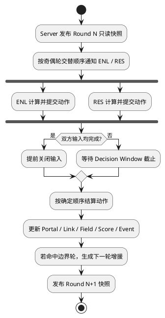

# 比赛、地图与增援

默认数值均引用 [`R-CONFIG`](./06-configuration.md)。

## R-TIME-01 Round 生命周期

游戏采用离散回合制；一个 Round 表示游戏世界中的一分钟。Server 原子发布只读快照及共享内存中的 `current_round` 时，以自身单调时钟记录 `round_start`，并令 `deadline = round_start + DECISION_WINDOW`。随后发送 Round Start Signal：奇数轮先通知 RES、偶数轮先通知 ENL，再通知另一方；该信号表示结算完成并授予对应 Client 读取新快照的许可，Round 身份仍以共享内存为准。

每轮 Client 在该窗口内基于同一版本快照提交动作。Server 不等待 Client `READY`，MVP 也不执行赛前公平性校准；双方输入均完成时可提前关闭，deadline 后未提交的 Agent 视为空过。

RPC 到达时间与 Server 执行耗时只影响动作是否赶上截止时间和排序，不计入游戏内时间或得分。

## R-TIME-02 比赛长度

比赛共 `TOTAL_ROUNDS` 轮。按默认一秒决策窗估算，单场 wall-clock 时间约八分钟，再加 Server 结算耗时；双方提前提交可缩短比赛。

## R-TIME-03 Client 异常终止

从 `INITIAL_SPAWN_START` 发出后，若单方 Client 进程退出或其唯一 UDS 连接关闭，该方立即 `CLIENT_FORFEIT`，比赛终止且 MVP 不允许重连或恢复。若双方同时失联，或故障源属于 Server / Runner，则记为无评分基础设施错误，而不是按当时 Score 判胜负。

## R-MAP-01 坐标与边界

- 地图是二维平面，不使用经纬度。
- 坐标为整数，单位为 `COORDINATE_UNIT`，以避免距离、相交和面积计算中的跨平台浮点差异。
- 地图左下角为 `(0, 0)`；合法闭区间为 `0 <= x <= MAP_WIDTH`、`0 <= y <= MAP_HEIGHT`。
- 地图尺寸、Portal 数量及最小间距分别由 `MAP_WIDTH`、`MAP_HEIGHT`、`PORTAL_COUNT`、`PORTAL_MIN_DISTANCE` 定义。

例如坐标 `(351230, 178452)` 在默认单位下表示 `(3512.30 m, 1784.52 m)`；默认最大合法坐标为 `(600000, 600000)`。

## R-MAP-02 Portal 分布

地图不采用完全均匀随机。默认由 `CLUSTERED_PORTAL_RATIO` 的聚集点和其余均匀点组成，在 `PORTAL_CLUSTER_COUNT` 个随机中心附近按高斯或类似分布采样，并始终满足最小间距。目标是同时产生高密度核心区、稀疏区、边缘 Anchor、战略走廊和不规则 Link 几何条件。

地图在任何赛前或 Round 事件发生前一次性生成并冻结；此后完整 `Map Definition` 是比赛与 Replay 的输入。Replay 直接载入记录的 Portal ID 与坐标，不从 Seed 重新运行地图生成器，因此 v0.1 不把具体采样算法或跨版本再生成一致性列为规则契约。

## R-SPAWN-01 初始出生

每阵营初始拥有 `INITIAL_AGENTS_PER_FACTION` 个 Agent。双方 Client 均已连接并认证后，Server 原子发布完整地图，记录 `spawn_start` 与 `spawn_deadline = spawn_start + INITIAL_SPAWN_WINDOW`，默认提供 5 秒赛前窗口。ENL 与 RES 各通过一次 `SUBMIT_INITIAL_SPAWNS` 提交完整的 `agent_id → coordinate` 集合。集合必须精确覆盖该方全部初始 Agent，并作为整体校验和生效；它不是逐 Agent Command Stream，也不参与 Priority Bucket。

每个位置可以是地图闭边界内的任意整数坐标，不要求与 Portal 重合，多个 Agent 也可选择同一坐标。只有完整帧最后一字节在 `spawn_deadline` 前到达 Server 的集合才有资格进入赛前槽位。两方有效集合均就绪后，Server 立即结束赛前窗口、同时应用出生位置并进入 Round 1；在此之前任何一方都看不到对方选择。

Server 先校验消息 framing、大小、协议版本和已认证 Faction；通过这些信封校验的首个集合立即冻结该方赛前槽位，随后才校验 Agent 集合与坐标。Agent 缺失、重复、未知或坐标越界均使该方 `SPAWN_FORFEIT`，不允许修正重提，也不自动分配兜底位置。赛前截止时仍未冻结槽位同样判负；若双方均失败，则比赛无有效结果且不进入 Elo。详见 [ADR-0004](../../adr/0004-first-command-stream-submission-is-final.md)。

## R-SPAWN-02 增援

每经过 `REINFORCEMENT_INTERVAL` 轮，在该边界轮的动作结算、Field 计分和事件生成全部结束后，每阵营增加 `REINFORCEMENT_AGENTS_PER_FACTION` 个 Agent；双方新增 Agent 出现在同一个由专用 RNG 生成的位置，以引入局势变化而不单独偏向某阵营。每阵营每场累计增援不超过 `MAX_REINFORCEMENT_AGENTS_PER_FACTION`（默认 4）；剩余额度不足一批时只补足额度，达到上限后不再生成增援或增援事件。上限为 0 时不增援；终局轮不生成增援。

增援写入下一轮 Snapshot，并从下一轮起首次可见、可行动，不参与生成它的边界轮动作或得分。Round 100、200、300、400 结算后分别生成 Round 101、201、301、401 的增援。

| 可行动 Round | 每阵营 Agent 数 |
|---:|---:|
| 1—100 | 3 |
| 101—200 | 4 |
| 201—300 | 5 |
| 301—400 | 6 |
| 401—800 | 7 |
