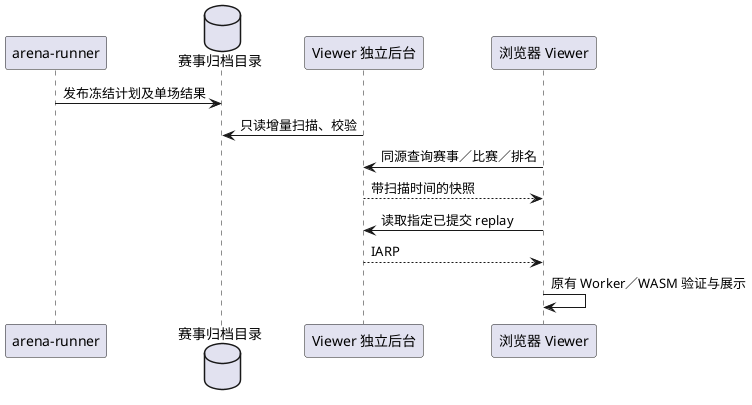

# Viewer 独立赛事监控

实现日期：2026-09-12。审查基点 `ff56010`，测试边界经用户确认：官方只读归档查询、真实后台 HTTP／CLI、浏览器赛事浏览与回放。验收记录见 [专题报告](../reports/viewer-tournaments.md)。

## 范围与职责

独立 Rust 后台同源提供 Tactical Replay 静态资源和只读赛事查询；直接读取显式允许的赛事目录，不依赖 runner 进程、网络接口或前端托管。支持赛事运行中接入、退出后浏览、多赛事、计划尚未完整发布、单场增量提交、结果筛选、暂定排名、attempt 历史及已提交 replay。现有手动打开 IARP 保留。

不修改规则、协议、IARP 或 runner CLI；不启动比赛、不自动恢复／补赛／重建，不添加遥测、心跳、逐轮实时观战或 AF_UNIX。没有稳定存活证据时，只显示磁盘记录的运行状态，不能把静默推断为死亡。



## 正确性要求

- 计划 manifest 和单场 artifacts 是发布契约；临时文件与未提交回放不作为结果。runner 收尾的根目录汇总不是实时事实源。
- 复用官方计划、产物、回放验证、结果采用及 Elo 语义，不另建计分规则。赛中按冻结赛程顺序聚合当前有效结果，排名标记暂定；全部调度项均有已验证终局后，按全量正常胜负批量拟合最终 Elo。技术结果不混入正常 W/D/L。响应的 `provisional` 与 `rating_method` 分别表示暂定状态及 `online_elo_v1`／`batch_elo_v1`，规则见 [P5-RANKING](./mvp/05-tournament-replay.md#p5-ranking-排名)。旧后台未提供新字段时，前端继续显示暂定排名。
- 每个逻辑比赛只计一次，历史 attempt 不重复计分。基础设施故障、技术结果、无回放、损坏分别展示。
- 原归档只读，监控不获取执行锁、不调用 rebuild。已验证内容按文件元信息缓存，变化后失效；下载前再核验所读字节。缓存不是防恶意篡改的签名机制。
- 扫描采用串行增量轮询；前端断线保留上次显示并标记过期，恢复后刷新。列表分页，回放按需加载，不预先物化全赛事。

## 安全与资源

默认仅回环地址；显式配置归档和静态资源根目录。严格验证 Host／Origin，不开放 CORS 通配。不接受任意文件路径，不暴露二进制、环境配置或原始目录；拒绝路径穿越、符号链接和非普通文件。访问只支持读取，限制请求头、连接处理数、超时和文件规模。

操作者必须控制归档目录，不能在读取过程中恶意替换目录／文件；本机服务不是任意恶意同用户程序的隔离边界，监控内容包含双方赛后私有信息，不授予参赛 Bot 访问权。CPU／I/O 与比赛仍共享，限制并发和重复验证，不宣称零影响。

## 使用

从 server 根目录构建（首次安装和 WASM 工具链见 [Viewer README](../../viewer/app/README.md)）：

```sh
cargo build --workspace
cargo build --manifest-path viewer/host/Cargo.toml
npm --prefix viewer/app run build
viewer/host/target/debug/arena-viewer serve --runs /path/to/tournaments --assets viewer/app/dist
```

打开终端打印的完整链接。默认绑定 `127.0.0.1:8080`，`--listen 127.0.0.1:0` 可分配空闲端口。每次启动生成随机访问令牌，通过 URL fragment 交给页面；页面移除 fragment，仅在当前标签页 sessionStorage 保存，查询和下载使用 Authorization 请求头。后台重启后重新打开新链接。不要公开包含令牌的终端输出。

`--runs DIR` 可以重复提供。每个 DIR 可以是一个赛事目录，或包含多个赛事的集合目录；只发现直接子目录，不递归扫描工作区。根目录需要预先存在，随后新创建的赛事会自动发现。赛事按路径生成定位 ID，复制到另一目录视为另一个入口；计划内容身份另行保存，不把名称当唯一身份。未完整发布或不兼容的计划显示错误／未就绪，不自动迁移历史目录。

`--poll-ms` 默认 2000，范围 100–60000。后台每轮扫描结束后等待该间隔，浏览器赛事页每 2 秒查询；“立即刷新”只读取最新快照，不强制重放整个赛事。首次验证随档案规模增长，不承诺固定延迟。相同计划被重新写入时复核内容；同一路径的计划身份改变则拒绝继续采用，需要操作者重启监控确认。单个事件损坏不阻止其他事件显示；集合目录暂时不可读时保留旧快照并禁用下载。

通过“赛事”按钮打开监控，“返回回放”退出。监控分为两个 tab：

- **赛事概览**：默认首屏，显示参赛人数、完成／未决／异常场次、暂定排名和 N×N 对决表。宽屏并排展示排名与对决表；窄屏纵向排列，表格内部滚动。
- **比赛详情与回放**：每场比赛以两行表格对照两名选手的胜负和技术统计；所选选手优先，否则胜者优先（平局按选手编号）。阵营作为身份辅助信息。支持精确选手／对手、名称／注册 ID／版本、地图编号、状态、选手视角胜负及技术指标筛选，每页 50 场。输入内容在“应用筛选”后生效，轮询不会提交尚未确认的输入。保留尝试记录和回放入口；窄屏表格独立横向滚动，选手列固定。

对决格按行选手的视角显示普通胜／平／负，合并全部地图和双方阵营。多场结果使用按数量占比绘制的分段渐变底色与底部色带，同时提供文字数量和完整提示；技术胜／负单列。未决包含待执行、记录为运行中和发布中；异常包含基础设施故障、中断及损坏；已完成的无评分结果另列。对角线不可点击，没有排赛的组合显示“无赛程”。每个逻辑比赛只采用当前最新 attempt，与官方监控结果采用方式一致，历史结果不重复计数。

点击有赛程的格子切换到详情 tab，清除先前筛选并设置精确选手／对手、回到第 1 页。两个方向的格子都查询该组合的全部比赛。tab 切换和回放往返保留已提交筛选与分页；换赛事时重置到概览。tab 支持方向键和 Home／End，后台轮询保留对决格及尝试记录的焦点。排名和对决汇总始终来自全赛事，不受列表筛选和分页影响，不通过前端抓取多页推算。

最新完成排序使用第三批 resources 中的完成时间，旧 attempt 缺少时间时用赛程编号作为稳定后备，不伪造完成时间。分数按原始 `score2` 十进制整数展示。无 IARP 的赛前失败显示无可用回放。

纯静态部署仍可手动打开 IARP，不必启动赛事后台。后台断开时已加载回放仍可查看、旧赛事列表保留；重新载入页面／Worker／WASM 仍需静态资源可访问，不承诺离线缓存整个应用。

远程使用建议后台与归档位于同一主机，通过 SSH 转发同一端口访问；Host 校验要求浏览器使用打印地址的 authority（例如远端监听与本地转发均为 `127.0.0.1:8080`）。不支持非回环地址或跨源模式。AF_UNIX、网络共享目录和远程多执行器汇聚不属于本批验收范围。

## 只读接口

所有数据接口要求 `Authorization: Bearer <token>`，页面与接口同源。仅 GET，无请求体，无 CORS 通配。未知资源返回 404；非法查询返回 400；未授权返回 401；Host／Origin 不符返回 403；写方法返回 405；回放未就绪／验证失效返回 409。

| 路径 | 返回 |
|---|---|
| `/api/events` | `arena-catalog-v1`：赛事摘要、扫描时间及目录级错误 |
| `/api/events/<id>` | `arena-monitor-v1`：选手、计数、排名、全赛事 `matchups`、分页比赛及 attempts；未就绪时只有定位与错误字段 |
| `/api/events/<id>/matches/<index>/attempts/<number>/replay` | 已提交且验证通过的原始 IARP 字节 |

详情查询参数：`offset`（默认 0）、`limit`（默认 50，1–200）、`q`（名称／ID／版本子串）、`entrant`／`opponent`（非负选手编号，均匹配任一阵营，同时提供则限定该组合，二者相同返回 400）、`map`（地图编号）、`state`、`outcome`、`attention`、`order`。空筛选代表全部，重复和未知参数拒绝。状态为 pending、recorded_running、publishing、completed、infrastructure_fault、interrupted、corrupt；liveness 始终为 unknown，不获取执行锁来推断存活。

- `outcome=win|loss` 仅匹配所选 `entrant` 的普通胜负；`technical_win|technical_loss` 匹配技术胜负，独立于普通胜负。`win`、`loss`、`technical_loss` 未提供 `entrant` 时返回 400；未选选手的 `technical_win` 保持兼容，表示全部技术判胜。`draw`、`unscored` 以及旧接口的 `enl_win|res_win` 继续支持。
- `attention=high_idle|zero_score|submission_issue` 分别匹配 Agent 空过比例 ≥50%、已完成至少一轮且得分为零、存在未提交或拒绝。选择选手时只看该选手，否则任一方满足即匹配。缺失统计不会被当作零。
- `order=latest|schedule|score|idle|destruction`；后三项按总得分、Agent 空过比例、Portal + Link + Field 摧毁次数从高到低排序。按所选选手排序，未选时取双方较高值；未知统计排末尾，同值按比赛编号倒序。排序、筛选均在服务端分页前进行。

每个 attempt 增加可空 `statistics`：包含 `rounds` 与 `enl`／`res` 两份选手统计。每方字段为十进制字符串 `score2`，以及整数 `portals_captured`、`portals_destroyed`、`links_created`、`links_destroyed`、`fields_created`、`fields_destroyed`、`agent_rounds`、`pass_slots`、`not_submitted_slots`、`rejected_slots`、`idle_rounds`。统计复用官方 committed-result 校验已解码且已验证的回放，仅缓存紧凑汇总；不再执行第二次回放，不写归档。归档变化时按原缓存失效机制重新验证，发布中或损坏尝试不暴露旧统计；无回放显示缺失，异常结束有有效回放时展示实际已完成轮数和得分。

Portal 建立计成功占领，摧毁计中立化；Link／Field 计建立和摧毁事件，重复建立计次数，连锁摧毁归攻击方。`agent_rounds` 计每轮实际活跃 Agent 的 slot，包含已加入的增援。全队空过 `idle_rounds` 仅在所有活跃 Agent 均 PASS 或未提交时增加；Agent 空过比例为 `(pass_slots + not_submitted_slots) / agent_rounds`。拒绝独立统计；执行失败的命令不算 PASS，移动／补给不因无公共事件而被算空过。零轮比例不适用。

表格使用 BigInt 将 score2 精确除以 2 显示总得分，得分数据条按本场占比，结构数据条按本场同类四个计数的最大值缩放，空过条显示实际比例。文本与颜色共同提示高空过、零分、未提交、拒绝及技术判定；分差占双方总分 ≤5% 提示胶着，≥90% 提示悬殊，双方零分不计算分差比例。提示仅作为回看线索，界面提供计算口径说明。

`matchups` 是按 `a < b` 排序的稀疏组合数组，只包含有赛程的组合。每项包含 `a`、`b`、`total`、`a_wins`、`b_wins`、`draws`、`a_technical_wins`、`b_technical_wins`、`pending`、`faults`、`unscored`，八个结果计数之和等于 `total`。普通胜者复用官方 `normal_winner` 的阵营映射；不会重新比较比分或改变 Elo。该扩展由 viewer host 从完整的官方类型化快照生成，无需下载回放。更新前端时需同步构建并重启 host；旧后台缺少汇总时前端明确提示，不将当前页伪装为全赛事。

后台使用一个串行扫描线程和 8 个固定 HTTP worker；请求头至多 16 KiB／64 个字段，读取请求头总期限 5 秒，写响应总期限 15 秒，一次连接只处理一个请求。单文件上限 512 MiB，其中 attempt 的 state／reason.txt 文本进一步限制为 64 KiB；归档树限制深度与条目数，临时目录也接受检查。这是局部防御上限，不是进程 RSS／CPU 配额。首次归档验证和磁盘读取不受网络写超时强制中断，后台不提供实时性能 SLA。

HTTP 请求解析使用独立工具依赖 [httparse 1.10.1](https://docs.rs/httparse/1.10.1/httparse/struct.Request.html)，不提供通用 Web 服务器功能。后台采用 [viewer/host](../../viewer/host/src/main.rs) 独立 Cargo workspace／锁文件，沿用 viewer/wasm 的隔离方式；HTTP 依赖不进入根 Cargo.lock、SDK 或 WASM 依赖闭包，不扩大选手审核白名单。官方只读查询位于 [monitor 模块](../../crates/arena-runner/src/tournament/monitor.rs)，复用既有结果验证和计分逻辑；后台只依赖库，不需要启动 arena-runner。

## 验收

1. 真实 runner 计划／比赛可被只读查询；进行中单场已提交结果在整批结束前可见，崩溃／退出后仍可浏览。
2. 原始目录不被监控改写；未提交文件不发布；损坏不伪装完成；重试不重复计分；分数以十进制字符串跨 JSON 传递。
3. HTTP 真进程覆盖静态文件、查询、原始 replay、路径／Host／Origin／写方法拒绝、并发和启动参数错误。
4. 浏览器真后台覆盖刷新、筛选、选手版本、排名、打开 replay／返回保留筛选、断线和手动文件模式；保留现有回放回归测试。
5. 单项测试和类型检查随迭代执行；结束执行全量 Rust／浏览器测试、格式检查、双轴审查并提交。
