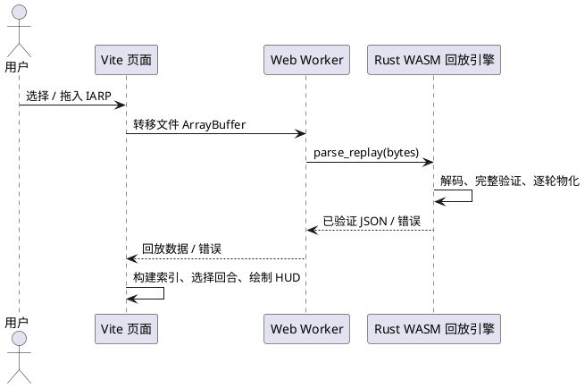

# Tactical Replay

正式回放前端采用 Vite + TypeScript + SVG，遵循 HUD 设计稿的顶部比分、左侧阵营名册、中央地图、右侧 Agent 档案和底部时间轴布局。所有页面资源随构建本地提供，无字体 CDN 或服务端 API。

## 启动

前置条件：仓库固定的 Rust 工具链、Node.js 22.12+（本次使用 24）、npm。首次安装：

```sh
rustup target add wasm32-unknown-unknown
cargo install wasm-bindgen-cli --version 0.2.100 --locked
cd viewer/app
npm ci
npm run wasm
npm run dev
```

打开 Vite 输出的地址，选择或拖入 `.iarp`。文件全部在浏览器本地处理。生产构建使用 `npm run build`，预览使用 `npm run preview`；将 `dist/` 部署至任意静态 HTTP 服务即可，也支持部署在子目录。构建步骤会重新编译 WASM，不依赖本地实验归档或未跟踪设计稿。

修改 Rust 回放代码后重新运行 `npm run wasm`。生成的 WASM、npm 依赖和构建输出不提交，Rust 和 npm 依赖由各自 lockfile 固定。

## 操作

| 操作 | 功能 |
|---|---|
| 文件按钮 / 拖入 `.iarp` | 本地读取、校验并载入回放 |
| Space、播放按钮 | 播放 / 暂停；在末轮播放会从头开始 |
| ← / →、Home / End | 逐轮步进、跳到初始状态 / 最后完成回合 |
| 滑块、回合数字框、得分曲线点击 | 跳转回合；R0 为初始状态 |
| 速度按钮 | 0.5×、1×、2×、4×、8× |
| 名册 / 地图 Agent、[ / ] | 选择 Agent / 循环选择当前视角可见 Agent |
| G / E / R、V、视角按钮 | GOD / ENL / RES、循环视角；PUBLIC 隐藏所有 Agent 私有信息 |
| 滚轮、+ / −、缩放按钮 | 以指针或视图中心缩放 |
| 拖动 | 地图平移 |
| Shift + 拖动、框选放大按钮 | 放大指定区域 |
| 全图、定位 Agent | 恢复全图 / 以选中 Agent 为中心放大 |
| Hover / 聚焦 Key | 地图高亮对应 Portal，提示可见持有人 |
| Hover / 聚焦 Portal | 地图及名册高亮当前持有该 Key 的可见 Agent |

输入框和按钮保留原生键盘行为，不拦截正在编辑的文字或数字。

地图使用厘米原始坐标、Y 轴向上，位置面板以米显示。缩放时图标和文字保持屏幕尺寸，位置、轨迹和操作半径按真实比例缩放。Agent 重叠时可通过名册或 `[ / ]` 选择。选中 Agent 的历史成功移动逐段显示，当轮所有成功移动用亮白线高亮；失败 Move 不画轨迹。每五轮标记历史轮次，操作范围圈使用比赛配置中的真实半径，Portal 外弧表示 HP 比例。当轮 MOVED 是全部成功移动的整数距离预算之和。设计稿的 MOCK 把移动标注为 SU；正式界面按实际引擎标注距离（米），移动不消耗 Supply。

## 数据与验证

原始 IARP 不保存逐轮私有完整快照。Worker 通过 `tools/replay-web` 的 wasm-bindgen 边界调用现有 `replay-export::build_payload`，复用 Rust 引擎完成解码、逐轮哈希 / 事件 / 得分 / 调度结果验证，再生成每轮状态。未通过验证的文件显示错误，保留上一份已载入回放；重新选择文件会终止上一 Worker，避免结果串场。零轮及技术性终止归档显示实际完成轮数和归档结果。



数据扩展在既有 `ingress-viewer-v1` 上增加 `keys[faction][roundIndex][agentId]` 与 `commands[faction][roundIndex][agentId]`。commands 保存最终 slot 状态、执行顺序 / bucket / seq、命令参数与结果，以及成功移动的 `from`、`to`、`cost_cm`。下标 0 对应第一轮结束；R0 的位置和 Supply 来自 Header。Key 通过权威 `Observation` 读取，命令使用第一份可定位提交及已验证 Resolver 报告；不从 Move 意图或公开事件猜测库存。

当前页面是归档分析工具，IARP 包含双方私有信息。阵营 / PUBLIC 按显示视角过滤，不能据此把原始 IARP 当作保密分发格式。需要仅向一方分发时继续使用仓库现有 `replay-export --faction enl|res`；新增 keys / commands 同样遵守该导出的阵营过滤。

`score2` 用十进制字符串传输，比分由 BigInt 精确换算为面积分；曲线仅在绘图时转为浮点。首次载入需要完整验证和物化，耗时随回放规模增长；完成后跳转直接访问内存中的逐轮快照。`VERIFIED` 表示回放内部一致性，完整哈希可悬停该标签查看。

## 测试

从仓库根目录生成确定性浏览器测试归档及原生 JSON 对照：

```sh
cargo test -p replay-export hud_telemetry_and_browser_fixtures
cd viewer/app
npm run build
npx playwright install chromium --no-shell
npm test
```

浏览器测试运行于生产构建，覆盖完整 WASM / 原生数据一致性、本地打开及拖入、损坏文件、异常及零轮结束、多段移动与失败命令、Supply、双向 Hover、框选 / 滚轮缩放 / 平移、播放 / 跳转 / 快捷键、增援和视角隔离，以及 390 px 窄屏布局。截图位于 `test-results/`。Rust 测试逐轮与 `Observation` 和 `RoundReport` 对比扩展数据，并检查单阵营导出不会携带另一方库存和命令。

实现采用 [Vite 官方 Worker 入口形式](https://vite.dev/guide/features#web-workers) 与 [wasm-bindgen 的 web 输出模式](https://wasm-bindgen.github.io/wasm-bindgen/reference/deployment.html)。
